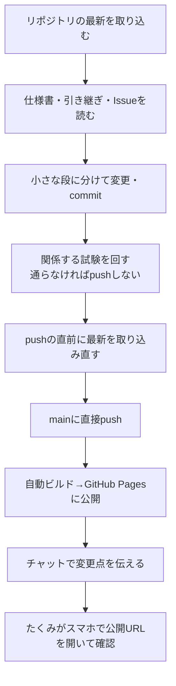

# tackle-lab 開発ルール（Claude向け）

釣りの仕掛けを設計するスマホ向けPWA「tackle-lab」の作業ルール。
仕様は `docs/spec.md`、進行中の作業は `docs/handover/` の「状態：使用中」の文書を見る。

## 0. 前提

- 開発者：たくみ（趣味の開発者。プロではない）。コードは基本的に Claude が書く
- たくみの確認は **アプリを触っての動作確認が中心**。ときどき練習も兼ねてコードを読む
- 正本は GitHub の `thirabayashitools-ux/tackle-lab`（`main`）。**公開リポジトリ**
- claude.ai プロジェクトのナレッジは同期が遅れることがある。**取り込んだリポジトリの最新を優先**する

## 1. 作業の流れ

- ブランチは使わない。`main` に直接 commit・push する
- **push前の確認はとらない**。例外は次の2つ。事前にチャットで内容を説明し、OKをもらってから進める
  - 共有DBの構造を変えるとき（テーブル・列の追加/削除/改名、データの一括変換）
  - 共有DBのデータを一括で削除・書き換えるとき
- 1回の作業は1つの機能。Claude が中で小さな段に分け、段ごとに試験・commit・push する
- Claude のチャットを2つ同時に進めるときは、触るファイルを重ねない

## 2. commit と push

- commit の文は **日本語の短い説明**（例：`仕掛けエディタ：枝スの追加ボタン`）
- **中身の変更**（仕様・動き）と **書き直しだけの変更**（整形・リファクタリング・表現）は、同じ commit に混ぜない
- まずい変更は `git revert`（取り消しの commit）で戻す。履歴の書き換え（force push）はしない
- commit の末尾には、セッションで指示された Co-Authored-By などの行を付ける

## 3. push のあとにチャットで伝えること

1. 変えたファイルと、何をどう変えたか
2. 中身（仕様・動き）の変更と、表現だけの変更を分けて書く
3. Claude の判断で仮に決めたこと（仕様書にも【要確認】で書く）
4. 回した試験と結果（回していなければ、そう書く）
5. スマホでやること（例：公開URLを開いて○○を試す）

## 4. 試験

- 計算・データ処理（強度計算、換算、集計など）は **Vitest で自動テスト** を書く
- 画面の試験は、必要になったら追加する（方法はそのとき決める）
- 段ごとには、変えた所に関係する試験だけ回す。機能の区切りで全部回す
- 文書だけの変更では回さない
- GitHub Actions でビルドと試験を回し、**失敗したら公開しない**（前の版のまま残る）

## 5. コメントの書き方

たくみがコードを読んで練習・保守できるように、**コメントは詳しく書く**。コードよりコメントが長くなってもよい。

- 日本語で書く
- **ファイル先頭**：そのファイルの役割、他のどのファイルとつながっているか
- **関数ごと**：JSDoc で、何をするか・引数・戻り値・注意点
- **処理の中**：「何をしているか」より **「なぜそう書いたか」** を重視する
  - 例：「長さを0以上に丸めるのは、入力ミスでマイナスが入るとSVG描画が壊れるから」
- プログラミング用語・釣り用語・物理用語は、初めて出てくる所で短く説明する
- **コードを変えたら、関係するコメントも必ず同じ commit で直す**（古いコメントはないより悪い）

## 6. 文書の書き方

- 要件（何ができるか・データの形・決まり）は、**先に文章で決めて `docs/spec.md` に書いてから** コードを変える
- 画面は見本（Artifact など）で細かく詰めない。配置をざっくり決めて本体に作り、見た目はスマホで触りながら直す
- 決めていないことは、仮に決めて作り、使ってみて直す
- 仕様書には「今どう動くか」「決まり」「決めた理由」を書く。経緯は書かず、git の履歴に任せる
- Claude が仮に決めたこと・未確認の数値は、**その節に【要確認】を付けて書く**。別の章に集めない
  - 理由：ナレッジ検索は文の近くの塊しか返さないので、別の章に集めると見落とす
  - 一覧が欲しいときは、リポジトリで「【要確認】」を文字検索する
- 矛盾や不明点は勝手に直さない。【要確認】を付けて残し、チャットで伝える

## 7. Issues

- タスク・不具合・たくみの判断が必要な相談は GitHub Issues で管理する
- たくみが不具合をチャットで報告したら、**Claude が Issue にする**
- 1つの Issue は、スマホで1回動作確認すれば終わる大きさにする
- Issue の本文は「やること」「完了の条件（スマホでこう動けばOK）」「確認手順」の3点
- ラベル

| ラベル | 用途 |
|---|---|
| `feature` | 新しい機能 |
| `bug` | 不具合 |
| `documentation` | 文書 |
| `question` | たくみの判断が必要な相談 |
| `phase-1`〜`phase-5` | どのフェーズの作業か |

- マイルストーンはフェーズごと（`Phase 1`〜`Phase 5`）
- commit の文に `#番号` を書いて Issue と紐づける。完了したら `close #番号` で閉じてよい

## 8. 引き継ぎ文書

- `docs/handover/` に置く。名前は `日付-話題.md`（例：`2026-11-09-kickoff.md`）
- 先頭に `状態：使用中` と「次のチャットでの頼み方」（そのまま貼れる1文）
- 「次にすること」は **push のたびに** 今の状態に直す（チャットが途中で切れても続けられるように）
- 役目を終えたら、決まったことを仕様書に取り込み、状態を「完了」にして `archive/handover/` に移す
- `archive/` はナレッジに取り込まない

## 9. 公開リポジトリとしての注意

- パスワード・APIの秘密鍵・個人情報はリポジトリに入れない
- 共有DBの「公開してよい鍵」（例：Supabase の anon key）は、DB側のアクセス制限（RLS）を設定してから使う
- 釣りのポイントなど、公開したくない情報をテストデータに入れない
