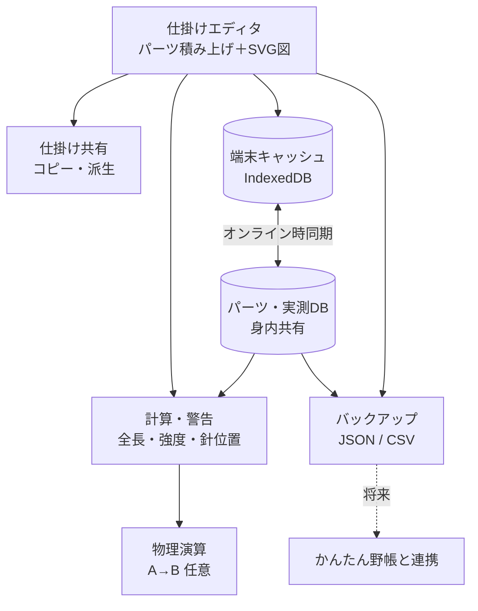

# tackle-lab：釣り仕掛け設計アプリ 要件メモ（たたき台）

> 雑談ベースで整理した初期構想。実装前に見直す前提。
> 最終更新: 2026-11-09

## TL;DR

- 仕掛けを **パーツの積み上げ** で組み立て、**SVG図** と **強度・長さの自動計算** を出すスマホ向けPWA
- パーツの **公開スペック／実測値DB** を **身内で共有**（ログインなし・名前入力のみ）
- 物理演算（潮受け・たるみ）は **比較用ツール** と割り切り、余裕があれば実装
- 釣果記録は **今回は対象外**（将来「かんたん野帳」連携＋リファクタリング時に検討）

---

## 1. 目的

- 仕掛けの設計・比較・改良を、図と数値でやりやすくする
- 強度計算の精度を、メーカー公表値と身内の実測値で上げていく

## 2. スコープ

### 対象

| 機能 | 優先度 |
|---|---|
| 仕掛けエディタ＋SVG図 | 高 |
| 計算・警告 | 高 |
| パーツ・実測DB（共有） | 高 |
| 仕掛けの共有・コピー派生 | 中 |
| バックアップ／復元 | 中 |
| 物理演算 | 低（任意） |

### 対象外（現時点）

- 釣果記録・ポイント情報・写真
  - 将来「かんたん野帳」と連携する場合に、リファクタリングとセットで対応

---

## 3. 機能要件

### 3.1 仕掛けエディタ

- パーツを上から順に積む（例: 道糸 → サルカン → 幹糸 → 枝ス＋針 → 捨て糸 → オモリ）
- 各パーツ: 種類、製品（DB参照）、号数、長さ、色、メモ
- 構成タイプ: 胴付、天秤、捨てオモリ式 など
- 入力から **SVG仕掛け図を自動生成**
- 仕掛けは **パーツの配列（JSON）** として保持する（図・計算・連携の共通土台）

### 3.2 計算・警告

- 全長、枝ス間隔、オモリからの針位置
- 号数 → 強度（kg / lb）換算
- **結束強度（ノットによる強度低下）** を考慮した実効強度
- 最弱点の表示と警告
  - 例: 捨て糸がハリスより強い → 根掛かり時に仕掛けごと切れる
- 竿の長さに対して仕掛けが長すぎないかのチェック

### 3.3 パーツ・実測DB

- 値は「**誰が・何を根拠に**」とセットで保存

| 項目 | 例 |
|---|---|
| 製品 | ○○フロロ 4号 |
| 値の種類 | 直径 / 強度 / 比重 / 線径 |
| 値 | 0.330mm |
| 出典 | メーカー公表 / 実測 |
| 測定条件 | ノット名、試行回数 |
| 入力者 | 名前 |
| 日付 | 2026-11-09 |

- 実測は **1回の測定＝1行** で追加 → 平均・n・標準偏差を集計表示
- 計算に使う値（公表値／実測平均）を切り替え可能に
- 線径・比重は主に **沈下・潮受け計算** 用、強度は主に **結束強度** が支配的

### 3.4 仕掛けの共有

- 身内に公開
- 他人の仕掛けを **コピーして改造（派生）** できる
- 派生元を記録し、系譜をたどれるようにする

### 3.5 物理演算（任意）

| レベル | 内容 | 難易度 |
|---|---|---|
| A | パーツごとの潮の抵抗と沈む力の比較 | 低 |
| B | 2D静的つり合い（ランプドマス法） | 中 |
| C | 時間変化つきシミュレーション | 高 |

- まずは A → B を目標。C はやらない想定
- 水深ごとの潮の速さは不明なので、**結果は相対比較用**
- 抗力係数などは文献値で仮置き → 実測で補正

---

## 4. 共有・権限

- **ログインなし**、名前を入力するだけ（一度入れた名前は端末に記憶して表記ゆれを防ぐ）
- 上書き・削除は **許可**
- URLが外部に漏れたときに備えて、**合言葉** を後から追加できるようにしておく

## 5. 安全策（上書き・削除OKの代わり）

### 5.1 確認ポップアップ

| 操作 | 表示する内容 |
|---|---|
| 新規保存 | 追加する内容 |
| 上書き | 変更前 → 変更後の比較 |
| 削除 | 対象名と件数 |
| まとめて削除 | 対象名を入力しないと実行不可 |

- 削除直後に数秒「**元に戻す**」ボタンを表示（Gmail方式）

### 5.2 バックアップ／復元

- 書き出し形式
  - **JSON**: 復元用（データを丸ごと残せる）
  - **CSV**: 閲覧用（Excel・スプレッドシート）
- 復元方法
  - 全部置き換え
  - 不足分だけ追加（他の人の最新入力を消さない）
- 「最後のバックアップから○日経過」のリマインド
- アプリを開いたときに、端末へ自動で控えを保存

---

## 6. 将来の連携に向けた仕込み

- 仕掛けに **UUID**（変わらないID）を振る
- 仕掛けを **単体でJSON書き出し** できるようにする
  - 野帳側に「使った仕掛けID＋その時点のJSON」を残せば、あとから仕掛けを改良しても記録がずれない

---

## 7. テックスタック案

| 役割 | 候補 |
|---|---|
| 画面 | React + Vite |
| 図 | SVG |
| 端末保存 | IndexedDB（Dexie.js） |
| 共有DB | Supabase / Cloudflare D1 |
| 重い計算 | Web Worker |
| 公開 | GitHub Pages / Cloudflare Pages |
| 形態 | PWA |

- オフライン（船上）でも使えるよう、端末に保存 → 電波が戻ったら同期
- 開発環境: Termux（node / vite）でも可能。本格的な作業は Windows のほうが楽

## 8. 構成イメージ

## 9. 開発フェーズ案

1. 仕掛けエディタ＋SVG図（端末保存のみ）
2. パーツ・実測DB＋強度計算
3. 共有DB・同期・確認ポップアップ・バックアップ
4. 仕掛け共有（コピー・派生）
5. 物理演算 A → B

---

## 10. 未確定・要確認

- [ ] 結束強度の具体的な数値（ノット別。文献・実測で確認）
- [ ] Supabase 無料版の休止条件（一定期間アクセスがないと停止。期間は要確認）
- [ ] 各サービスの無料枠（DB容量・ストレージ）
- [ ] 共有DBをどれにするか（Supabase / Cloudflare D1）
- [ ] 合言葉を最初から入れるか、後から入れるか
- [ ] 物理演算用の抗力係数などの文献値
