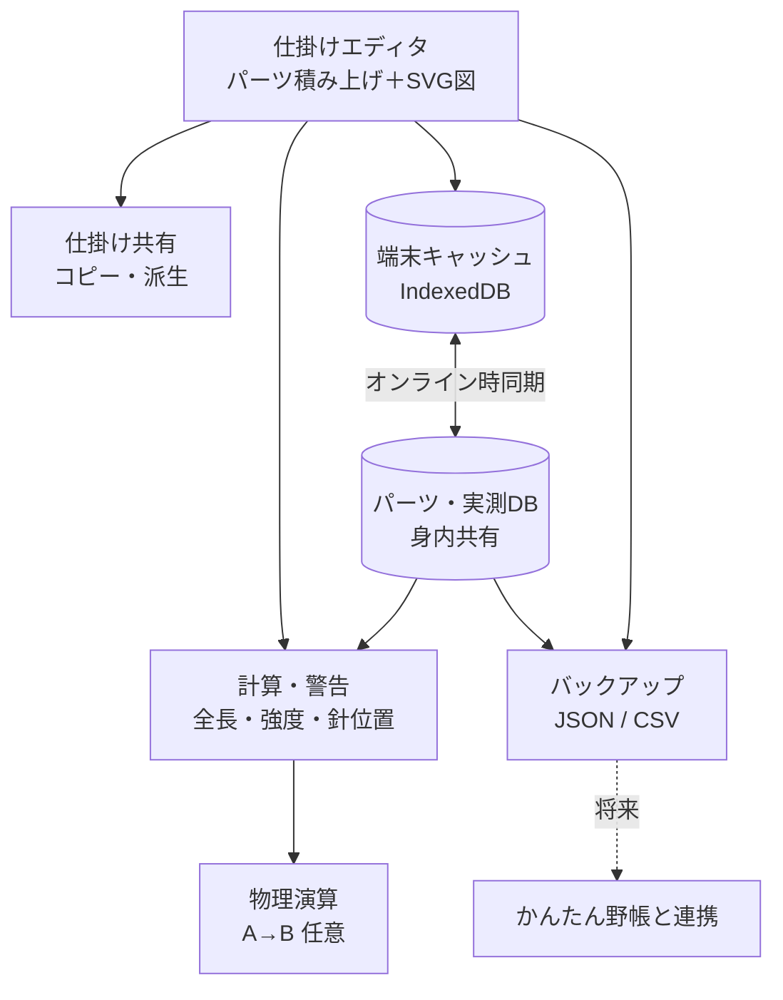

# tackle-lab 仕様書

釣りの仕掛けを設計するスマホ向けPWA。作業ルールはリポジトリ直下の `CLAUDE.md`。

- 版：0.1（たたき台。まだ実装なし）
- Claude が仮に決めたこと・未確認の数値には【要確認】を付けている

## 1. 概要

- 仕掛けを **パーツの積み上げ** で組み立て、**SVG図** と **強度・長さの自動計算** を出す
- パーツの **公開スペック／実測値DB** を **身内で共有**（ログインなし・名前入力のみ）
- 物理演算（潮受け・たるみ）は **比較用ツール** と割り切り、余裕があれば作る
- 釣果記録は **対象外**。将来「かんたん野帳」と連携するときに、リファクタリングとセットで考える

### 1.1 目的

- 仕掛けの設計・比較・改良を、図と数値でやりやすくする
- 強度計算の精度を、メーカー公表値と身内の実測値で上げていく

### 1.2 スコープ

| 機能 | 優先度 | フェーズ |
|---|---|---|
| 仕掛けエディタ＋SVG図 | 高 | 1 |
| パーツDB＋計算・警告 | 高 | 2 |
| 共有DB・同期・バックアップ | 中 | 3 |
| 仕掛けの共有・コピー派生 | 中 | 4 |
| 物理演算 | 低（任意） | 5 |

対象外：釣果記録・ポイント情報・写真

### 1.3 用語

画面・仕様書・コードで同じ言葉を使う。コード上の名前もこの表に合わせる。

| 呼び方 | コード上の名前 | 意味 |
|---|---|---|
| リグ | `rig` | 1つの仕掛け。保存・コピー（派生）・書き出しの単位。上の端は道糸（またはタックル側のリーダー）に結ぶ所 |
| タックル | `tackle` | 竿・リール・道糸・リーダーなど、竿の側に付いたままのもの。リグとは別に持ち、エディタで切り替えて組み合わせる（2.5） |
| ピース | `piece` | リグを作るいちばん小さい単位。ライン・パーツ・接続のどれか1つ |
| ライン | `line` | ピースのうち、リグの中で力を受け持つ糸。長さを持ち、両端がほかのピースと接続でつながる。幹糸・ハリス・枝ス・捨て糸・リーダーなど |
| パーツ | `part` | ピースのうち、ライン以外の物。オモリ・サルカン・スナップ・天秤・針・ビーズ・うき止め・ゴム管・ハリス止めなど |
| 接続 | `joint` | ピースどうしがつながる所、またはラインの上の結び目。物そのものではないが、強さ（結束強度など）を持つのでピースの1つとして扱う。種類は下の表 |
| レイアウト | `layout` | 図の上でのピースの置き方と描き方（角度・色など）。計算には使わない |
| セットアップ | `setup` | タックル1つとリグ1つの組み合わせ。名前を付けて保存できる（例：アマダイ船・いつもの）。中身はタックルとリグのIDを指すだけで、タックルやリグそのものはコピーしない |

- セットアップがあるので、リグにはタックルのIDを持たせない。「いつもの組み合わせ」はセットアップとして保存する
- タックルやリグを消したとき、それを指すセットアップは消さずに「タックルがありません」などと出す【要確認】
- セットアップを作れるようにするのは、タックルの画面と同じフェーズ【要確認：Phase 2 の想定】
- 「仕掛け」は、ふだんの言葉としてはリグと同じ意味で使ってよい
- うき止め糸は糸だが、ラインに巻き付けて止めるだけで、魚やオモリの重さはかからないのでパーツに入れる。ラインとパーツは「力を受け持つ糸かどうか」で分ける
- パーツには、ラインとラインの間・ラインの端に付く物（サルカン・オモリ・針など）と、ラインの上に乗る物（ビーズ・中通しオモリ・うき止めなど）がある。この違いは接続の種類で表す
- 色はレイアウトに持たせる（図の上での色）。入れなければ種類ごとに決まった色で描く（例：フロロとナイロンで色を変える）。実物の色はエディタで見る必要がほぼないので、ピースには持たせない。残したいときはメモか、Phase 2 の製品DBに書く【要確認】
- 「部品」はふだんの言葉としてはピースと同じ意味で使ってよい。「オブジェクト」は JavaScript の言葉と紛れるので使わない

向きと荷重

- 「上・下」という言い方は使わない。考えるのは力がかかる向きだけにする。つながり（どのピースが何につながっているか）と、海の中での向きを混ぜないため

| 用語 | 意味 | 何に使うか |
|---|---|---|
| タックル側 | つながりをたどって、タックルに近づく向き | 構造の基本。どのピースからも、タックルへの道は1本に決まる |
| 先側 | タックル側の反対。タックルから遠ざかる向き | 枝分かれの先をたどるとき（「先糸」の「先」） |
| 重力の向き | オモリなどの重さがかかる向き | 物理演算（Phase 5）。模式図では下向きに描く |
| 荷重の向き | 魚や根掛かりで引かれる向き | 強度計算（3章） |

- **荷重点**：荷重がかかる所。魚が掛かった針、根掛かりしたオモリや針など
- **荷重経路**：荷重点からタックルまでの道すじ。荷重はこの道すじのピースにだけかかる
  - 3章の最弱点は、荷重点ごとに、その荷重経路の中でいちばん弱い所を探す
  - 例：オモリが根掛かりしたとき、荷重経路の中で捨て糸がいちばん弱ければ、捨て糸だけ切れて仕掛けが残る
- **先端**：ラインに沿って両側から引っ張られる向きのうち、片側は接続でつながり、もう片側には何もつながっておらず、魚や重力による引っ張りが始まる所（針、捨て糸の先のオモリなど）
  - ビーズのようにラインの途中に乗っているだけの物は、ラインに沿った両側がつながっているので先端ではない
- 「軸」「枝」という用語は作らない。樹木でいちばん長い先端が幹ではなく枝であるように、特別な一本を決めても計算の役に立たないため。計算は「どこからどこまでの長さか」で考える。「幹糸」「枝ス」はラインの役割の呼び名として残すが、計算では特別扱いしない
- 未定義（データの形を作りながら決める）【要確認】
  - 経路（2つのピースの間の道すじ）、分岐点（三又サルカン・天秤・エダス結びなど）
  - ラインの「端」と「途中」は、ラインのポイント（2.0）で表す。ラインは途中で2本に分けない
  - 通しの力の伝わり方。通しパーツにも力はかかる（中通しオモリの重さ、誘導パーツにかかるラインと垂直に近い力、ストッパーが受ける力）。荷重経路をどこまで単純にたどるかは 3章を詰めるときに決める
  - 製品（Phase 2 の製品DBの1品）とピースの違い
- リグの中に **輪はない**（ぐるっと回って元に戻るつながりはない）ものとする。輪になる仕掛けはほぼないため。これで、タックルへの道がどのピースからも1本に決まる
  - チチワ（糸の端に作る小さい輪）は結束1つとして扱うので、輪には当たらない

接続の種類

| 呼び方 | コード | 例 | 計算への影響 |
|---|---|---|---|
| 結束 | `knot` | クリンチノット、FGノット、エダス結び、玉留め | 結束強度の分だけ強さが下がる。ずれない |
| 連結 | `link` | スナップにサルカンを付ける、天秤の腕に付ける（輪と輪を掛け合わせる） | 金具の強さで決まる。ずれない |
| 通し | `slide` | ビーズ・中通しオモリ・うき止め・ゴム管に糸を通す。ハリス止め・ガン玉に糸を挟む | 動きにくさを持つ（数値の項目は将来の候補。2.0） |

- 接続には相手のピースがいなくてもよい。玉留めは、ラインの途中にある相手のいない結束
  - 結び目なので、そこでラインが弱くなる（3章の最弱点に出る）
- 通しの動きにくさは「ずれ始める力」。データに入れるのは将来（2.0 の「将来の候補」）（kg。3章の強度に単位をそろえる）
  - 0 なら自由に動く（ビーズ・中通しオモリ）、大きいほど動きにくい（うき止め・ゴム管・ハリス止め）。分からなければ空欄
  - 「止める」は「動きにくい通し」と考えるので、別の種類にしない。うき止めのように、一定の力でずれる仕組みもそのまま表せる
  - 通しのパーツは、上下にある物（玉留め・サルカン・うき止めなど）に当たって止まる。「止めておく働き」は種類としては持たない
  - Phase 1〜4 の長さ・高さの計算では、エディタで置いた位置にあるものとして扱う。ずれるか・当たって止まるかの計算は物理演算（Phase 5）
  - 実際の数値は実測でしか分からないので、4章の実測DBに入れられるようにする【要確認】
- ガン玉など、挟んだ所で糸が傷んで弱くなる通しには、結束強度のような「強さの下がり方」も持てるようにする（将来の候補。2.0）
- ラインのループ（チチワなど）も、サルカンのカンやスナップの輪も、同じ **環** として扱う。連結は「環と環をつなぐ」こと。ループを作る結び目そのものは、玉留めと同じく相手のいない結束としてそのポイントに付く

## 2. 仕掛けエディタ

- パーツを上から順に積む（例：サルカン → 幹糸 → 枝ス＋針 → 捨て糸 → オモリ）
- 竿・道糸は仕掛けに入れず、別の **タックル**（2.5）として持つ。エディタでタックルを切り替えて、組み合わせた計算を見る
- 構成タイプ：胴付、天秤、捨てオモリ式 など
- 入力から **SVG仕掛け図を自動生成**
- 仕掛けは **パーツの配列（JSON）** として持つ。図・計算・書き出し・将来の連携の共通の土台にするため
- 各仕掛けに **UUID**（変わらないID）を振る。名前は変わることがあるので、連携や派生の記録はIDで行う

【要確認】2.1〜2.4 は「パーツを一直線に並べた配列」が前提で書いてある。1.3 の用語（ライン・パーツ・接続を組み合わせた、枝分かれのある形）に合わせて作り直す途中。作り直すまでは、データの形の正本として使わない

### 2.0 作り直し中の新しい形

決まった所から書いていく。全部決まったら 2.1〜2.4 と置き換える。

#### 決まり：項目は、それを使う計算か画面ができるときに足す

- 今のデータに入れるのは、エディタと長さの計算に要る最低限だけ
- 理由：使わない項目を先に入れると、意味が使ってみるまで確かめられず、あとで中身がずれる。実物の仕掛けは立体で、潮やたるみで毎回違うので、厳密にしすぎても実釣とのずれは消えず、入力が面倒になるだけ
- `schemaVersion` があるので、あとから足しても古いデータは読み替えられる
- 考え方が決まっていてまだ入れない項目は、この節の最後の「将来の候補」に書く

#### ピースのポイント

- ラインもパーツも **ポイント** を持つ（ピース共通の決まり）
- ポイントは **形** を持てる。今あるのは **環**（`ring`。ラインのループ、サルカンのカン、スナップの輪など）。ほかに穴（中通しオモリ）、軸（外掛け結びが巻かれる針の軸）などが出てきそう【要確認】
- 接続は「どのピースのどのポイントと、どのピースのどのポイントをつなぐか」を持つ。相手のいない結束（玉留め・ループを作る結び目）は、ポイントを1つだけ持つ
- パーツのポイントの位置の持ち方は、ラインと変わりそう（パーツは環などの接続部を持ち、形も単純ではないため）【要確認：例の仕掛けで確かめる】

#### ラインのポイント

ラインの上の「何かがある所」を **ポイント** として持つ。ラインを途中で2本に分けずに、1本のラインの何cmの所に何があるか、で表す。

- 理由：実物の作り方（幹糸1本の途中にエダス結び、など）に近い。遊動の範囲（下の「幅」）も表せる。ラインを分ける形では、遊動の範囲をうまく表せない
- ポイントの位置は、**ラインの始まりからの距離**（cm）で持つ
  - 理由：前のポイントからの距離で持つと、前のポイントに幅があるとき、どこから測るかが決まらない。また、1つ動かすと先のポイントが全部動いてしまう
- ポイントは **幅** を持てる（始まり〜終わり）。幅のないポイントは、始まりと終わりが同じ
  - 例：遊動のオモリ・ウキ・サルカンを付ける範囲、摩擦系の結束（FGノットなど）が占める範囲
- ラインの **始まり（0）と終わりのポイントは必ずある**。消せない
- **ラインの長さは、終わりのポイントの位置**。長さの欄を別に持たない（同じ数字を2か所に持たないため）
- ポイントがラインの長さの外になったときは、保存はできるが、計算の前に警告を出す

画面での入力と表示

- 仕掛けの設計では「エダスとエダスの間が何cm」と考えることが多いので、途中にポイントがあるライン（幹糸など）は「前のポイントから何cm」で入れる・見る。保存するときに始まりからの距離に直す
- 途中にポイントがないライン（ハリスなど）は「長さ 30cm」として入れる。中身は終わりのポイントの位置
- **間隔を変えたら、それより先のポイントはまとめてずれる**（ほかの間隔は変わらず、ラインの長さが伸び縮みする）。エダスの間を詰めたとき、ほかのエダスどうしの間隔が崩れないようにするため
- 幅のあるポイントがあるときの間隔は、「前のポイントの終わりから、このポイントの始まりまで」とする【要確認：遊動の範囲で使ってみて決める】

#### ポイントの幅の意味

ポイントの幅（始まり〜終わり）の意味は、そこに付く接続の種類で決まる。

| 接続 | 幅の意味 |
|---|---|
| 結束（ふつうの結束・玉留め・チチワなど） | 幅なし |
| 結束（摩擦系の結束・外掛け結びなど） | 結び目が **占める範囲**。外掛け結びなら針の軸の上にも範囲がある |
| 通し | パーツが **動ける範囲**（遊動の範囲） |
| 連結 | 幅は使わない。遊びは下の「将来の候補」 |

- 占める範囲・動ける範囲は「ピースの上の位置」の話なので、ピースのポイントに持つ
- Phase 1〜4 の長さ・高さの計算に使うのは、この2つだけ

#### 将来の候補（まだデータに入れない）

| 項目 | 置き場所 | 考え方 | 使う所 |
|---|---|---|---|
| 遊びのずれる長さ | 環のポイントの内径から計算 | 環と環の中でずれる分。アタリの伝わりやすさに直結するので無視できない。接続に直接入れず、部品の寸法（製品DBの内径など）から出す【要確認：計算のしかた】 | 3章の「アタリの伝わりやすさ」の目安（荷重経路の上の遊びの合計）【要確認】 |
| 折れ曲がり範囲 | 接続（度） | つながった2つのピースが、どれだけ角度を変えられるか。環と環の連結はよく曲がり、摩擦結束は硬い | 図の角度（例：三又の角度をこの範囲の中でだけ動かす）、物理演算 |
| 動きにくさ（`holdForce`） | 通しの接続（kg） | 1.3 の「通し」を参照 | 物理演算 |
| 強さの下がり方（通し） | 通しの接続 | ガン玉など、挟んで糸が傷む分 | 3章の強度 |

- 遊びのずれる長さは、全長や底からの高さには入れない（数mmの差は、潮やたるみのぶれの中に入るため）
- データの単位は cm にそろえ、画面では小さい値を mm で見せる

### 2.1 仕掛けのデータの形

```json
{
  "schemaVersion": 1,
  "id": "UUID",
  "name": "アマダイ胴付き 2本針",
  "type": "dozuki",
  "memo": "",
  "derivedFrom": null,
  "bottomPartId": null,
  "createdAt": "2026-11-09T04:00:00.000Z",
  "updatedAt": "2026-11-09T04:00:00.000Z",
  "parts": [ /* 上から順のパーツ（2.2） */ ]
}
```

| 項目 | 意味 |
|---|---|
| `schemaVersion` | データの形の版。形を変えたときに古いデータを読み替えるため |
| `id` | 仕掛けの UUID |
| `name` | 名前 |
| `type` | 構成タイプ：`dozuki`（胴付）／`tenbin`（天秤）／`sute`（捨てオモリ式）／`other` |
| `memo` | メモ |
| `derivedFrom` | コピー元の仕掛けの `id`。コピーでなければ `null` |
| `bottomPartId` | 底に着くオモリのパーツの `id`（2.3）。`null` なら自動（いちばん下のオモリ） |
| `createdAt` / `updatedAt` | 作った日時・最後に変えた日時（ISO 形式） |
| `parts` | パーツの配列。**上（竿側）から下（オモリ側）の順** |

- 仕掛けを作る人の名前（入力者、`author`）は、共有を始める Phase 3 で足す
  - 理由：Phase 2 までは端末に保存するだけで、作った人は必ず自分なので使い道がない。`schemaVersion` があるので、あとで足しても古いデータを読み替えられる
  - 他の人の仕掛けをコピー（派生）したときは、コピーした人の名前になる。元の作者は `derivedFrom` をたどって分かる

### 2.2 パーツ

仕掛けの「軸」（竿からオモリまで一直線につながる部分）を上から順に並べる。枝スは軸から横に出るパーツとして、軸の途中に置く。

すべてのパーツに共通の項目

| 項目 | 意味 |
|---|---|
| `id` | パーツの UUID（並べ替えや画面の部品の区別に使う） |
| `kind` | 種類（下の表） |
| `length` | 軸の方向の長さ（cm）。枝スは軸の上で場所を取らないので 0 |
| `color` | 色（任意） |
| `memo` | メモ（任意） |
| `productId` | 製品DBの ID。Phase 2 で使う。それまでは `null` |

種類ごとの項目

| `kind` | 意味 | 追加の項目 |
|---|---|---|
| `line` | 糸 | `role`（リーダー `leader`／幹糸 `mikiito`／ハリス `harisu`／捨て糸 `sute`／その他 `other`）、`material`（ナイロン `nylon`／フロロ `fluoro`／PE `pe`）、`gou`（号数） |
| `connector` | 金具・小物 | `subtype`（サルカン `swivel`／三又サルカン `triSwivel`／スナップ `snap`／ビーズ `bead`／クロスビーズ `crossBead`／その他 `other`）、`size`（号数などの文字） |
| `branch` | 枝ス＋針 | `line`（`material`・`gou`・`length`）、`hook`（`name`・`size`） |
| `hook` | 軸の先の針（天秤など） | `name`、`size` |
| `sinker` | オモリ | `weight`（号。1号＝3.75g） |
| `other` | その他 | `name` |

- 長さの単位は cm にそろえる。釣りでは m と cm が混ざるが、計算のときの換算まちがいを防ぐため
- 金具の長さは、入れなければ 0 として扱う（全長への影響が小さいため）
- オモリの長さも、入れなければ 0 として扱う。ただしオモリは長いものもあり、底からの高さ（2.3）に効くので、入れることをすすめる
- 長さにマイナスや数字でない値が入ったら、計算では 0 として扱う

### 2.3 長さの計算

- **全長**：軸のパーツの `length` の合計（枝スは含めない）
  - 道糸は仕掛けに入らない（2.5 のタックル側）ので、全長にも入らない
  - 仕掛け側のリーダー（`role` が `leader` の糸）は、ほかの糸と同じく全長と位置に入る。リーダーの長さごと設計したいときに使うため
- **パーツの位置**：上の端からの距離と、下の端からの距離
- **底からの高さ**：枝スの付け根が、底に着くオモリの **下端** からどれだけ上にあるか
  - 船の胴付き・捨てオモリでは、オモリが底に着くので「底から何cm上に針があるか」が大事なため
  - 測る起点は「底に着くオモリ」（`bottomPartId`）の下端。つまりオモリの長さも高さに入る
    - 理由：実釣では、軽く糸を張ってオモリを立て、下端が海底にふれている状態が多い。長いオモリもあるので、上端から測ると実際より低く出る
    - たるみや底の硬さでオモリが倒れる・沈むなどは、物理演算（Phase 5）で扱う
    - `bottomPartId` が `null` なら、いちばん下のオモリを使う
    - 底に着くオモリは、いちばん下とは限らない。比重が軽い・小さい・他のパーツの潮の抵抗で浮く、などで上のオモリが着くこともある。オモリの形でも変わる。なので自分で選べるようにする
    - 2つ同時に着くときは、上のほうを選ぶ。その上のパーツの高さは上のオモリから測るのが正しく、2つの間の糸は底に寝ているため
    - Phase 5 の物理演算ができたら、計算で「着くはず」のオモリを出す。それでも自分で選んだほうを優先する（物理演算は比較用で、実際の海の様子までは分からないため）
    - `bottomPartId` が見つからない・オモリでないパーツを指しているときは、`null` と同じ扱いにする
  - オモリがないときは、軸のいちばん下の端から測る
  - 起点より下にあるパーツは、高さを「底」と表示する（底の上に寝ている扱い。数値は 0）
  - オモリの形（六角・ナス型など）と比重は、物理演算のときに `sinker` の項目として足す【要確認】
- **針先の高さ**は、Phase 1〜4 では計算も表示もしない。Phase 5 の物理演算で扱う
  - 理由：針先の高さは潮の流れで大きく変わる。「枝スがまっすぐ垂れたとき」の値を出しても、実際とずれた数字が一人歩きするため
  - それまでは、枝スの付け根の高さと枝スの長さを並べて出す
- **枝スの間隔**：となり合う枝スの付け根どうしの距離（上から順）

### 2.4 仕掛け図

- Phase 1 は **模式図**：軸はまっすぐ縦に描き、並びと長さを読みやすくする（地下鉄の路線図のような扱い）
  - 実際の糸は、潮やたるみ、途中のオモリで曲がる。正しい形は物理演算を解かないと出ないので、Phase 5 で **形の図**（物理演算で出た点を曲線でつなぐ）を足す
  - 作り直しを防ぐため、図を描く部分は最初から「糸を点の並びで受け取って描く」作りにする。Phase 1 は点が縦にまっすぐ並ぶだけ
- 底の線は、図のいちばん下に固定しない。底に着くオモリ（2.3）の下端に引き、それより下のパーツは線の下にそのまま描く（模式図なので、底に寝た形は描かない）
- 図の長さを実際の長さに比例させるか、長さ0のパーツ（金具・オモリ）をどれだけの大きさで描くか【要確認：#3 で触りながら決める】

### 2.5 タックル

竿・リール側に付いたままのもの（竿、道糸、リーダー）を、仕掛けとは別の「タックル」として持つ。

- 理由：道糸やリーダーは、仕掛けを替えてもリールに残る。仕掛けに入れると、同じ仕掛けを別の竿・別の道糸で使ったときに比べられない
- 仕掛けとタックルは別々に保存する。エディタでタックルを選ぶと、組み合わせた計算（3章の強度・最弱点、竿との長さの比較）を出す

```json
{
  "schemaVersion": 1,
  "id": "UUID",
  "name": "アマダイ用 PE3号",
  "rodLength": 240,
  "mainLine": { "material": "pe", "gou": 3 },
  "leader": { "material": "fluoro", "gou": 8, "length": 300 },
  "memo": "",
  "createdAt": "2026-11-09T04:00:00.000Z",
  "updatedAt": "2026-11-09T04:00:00.000Z"
}
```

| 項目 | 意味 |
|---|---|
| `rodLength` | 竿の長さ（cm） |
| `mainLine` | 道糸（`material`・`gou`）。長さは持たない。リールから出る何百mもの糸で、仕掛けの長さとは別に考えるため |
| `leader` | リーダー（`material`・`gou`・`length`）。なければ `null` |

- リーダーは **タックル側にも仕掛け側にも置ける**
  - ふだんはタックル側（仕掛けを替えても残るため）
  - リーダーの長さごと仕掛けを設計したいときは、仕掛け側に `role: "leader"` の糸として入れる
  - 両方に入っていたら、計算は仕掛け側を使い、画面に「リーダーが2か所に入っています」と出す。二重に数えないため
- リールは今は持たない【要確認：ドラグ力などで必要になるか】
- リグにはタックルのIDを持たせない。いつもの組み合わせはセットアップ（1.3）で保存する。セットアップを使わずに開いたときは、最後に選んだタックルを端末に覚えておく
- タックルの全長への扱い：仕掛けの「全長」はタックル側のリーダーを含めない。竿との長さの比較（3章）ではタックル側のリーダーも足す【要確認】
- タックルの入力画面をどのフェーズで作るか【要確認：強度計算と合わせて Phase 2 か】

## 3. 計算・警告

- 全長、枝スの間隔、オモリからの針の位置
- 号数 → 強度（kg / lb）換算
- **結束強度**（ノットによる強度の低下）を考慮した実効強度
  - 結束強度は元の強度のおよそ6〜9割【要確認：ノット別の数値を文献・実測で確かめる】
- 最弱点の表示と警告
  - 例：捨て糸がハリスより強い → 根掛かりのとき仕掛けごと切れる
- 竿の長さに対して仕掛けが長すぎないかのチェック【要確認：判定の基準】

## 4. パーツ・実測DB

値は「誰が・何を根拠に」とセットで持つ。

| 項目 | 例 |
|---|---|
| 製品 | ○○フロロ 4号 |
| 値の種類 | 直径 / 強度 / 比重 / 線径 |
| 値 | 0.330mm |
| 出典 | メーカー公表 / 実測 |
| 測定条件 | ノット名、試行回数 |
| 入力者 | 名前 |
| 日付 | 2026-11-09 |

- 実測は **1回の測定＝1行** で追加し、平均・n・標準偏差を集計して出す
- 計算に使う値（公表値／実測平均）を切り替えられる
- 線径・比重は主に沈下・潮受けの計算に使う。強度は主に結束強度で決まる

## 5. 共有・権限

- **ログインなし**。名前を入力するだけ。一度入れた名前は端末に覚えて、表記ゆれを防ぐ
- 共有するもの：パーツのスペック・実測値、仕掛け
- 上書き・削除は **許可**（安全策は6章）
- URLが外に漏れたときに備えて **合言葉** を後から足せる作りにする【要確認：最初から入れるか】
  - 公開リポジトリなので、合言葉をコードに直接書くと誰でも読める。入れるときは置き場所を考える【要確認】

## 6. 安全策

### 6.1 確認ポップアップ

| 操作 | 表示する内容 |
|---|---|
| 新規保存 | 追加する内容 |
| 上書き | 変更前 → 変更後の比較 |
| 削除 | 対象名と件数 |
| まとめて削除 | 対象名を入力しないと実行できない |

- 「本当に〜しますか？」だけだと読まずに押すクセがつくので、**何が変わるかを必ず出す**
- 削除の直後に数秒「元に戻す」ボタンを出す

### 6.2 バックアップ／復元

- 書き出し
  - **JSON**：復元用（欠けなく残せる）
  - **CSV**：閲覧用（Excel・スプレッドシート）
- 仕掛け1つだけをJSONで書き出すこともできる（将来の野帳連携用）
- 復元は「全部置き換え」か「足りない分だけ追加」を選ぶ。共有DBで他の人の最新入力を消さないため
- 「最後のバックアップから○日」のリマインドを出す【要確認：何日で出すか】
- アプリを開いたとき、端末に自動で控えを残す

## 7. 仕掛けの共有・派生

- 身内に公開する
- 他の人の仕掛けを **コピーして改造（派生）** できる
- 派生元のIDを記録し、系譜をたどれるようにする

## 8. 物理演算（任意）

| レベル | 内容 | 難易度 |
|---|---|---|
| A | パーツごとの潮の抵抗と沈む力の比較 | 低 |
| B | 2Dの静的つり合い（ランプドマス法） | 中 |
| C | 時間変化つきシミュレーション | 高 |

- A → B を目標にする。C はやらない
- 水深ごとの潮の速さは分からないので、**結果は相対比較用**
- 抗力係数などは文献値で仮置きし、実測で補正する【要確認：文献値】
- 重い計算は Web Worker（画面の裏で計算させる仕組み）で動かし、画面が固まらないようにする

## 9. 技術構成

| 役割 | 使うもの |
|---|---|
| 画面 | React + Vite |
| 図 | SVG |
| 端末保存 | IndexedDB（Dexie.js） |
| 共有DB | Supabase か Cloudflare D1【要確認】 |
| 試験 | Vitest |
| 重い計算 | Web Worker |
| ビルド・公開 | GitHub Actions → GitHub Pages |
| 形態 | PWA |

- 船の上でも使えるように、端末に保存しておき、電波が戻ったら共有DBと同期する
- 公開先は GitHub Pages。リポジトリが公開なので無料で使える
- URL は https://thirabayashitools-ux.github.io/tackle-lab/ 。カスタムドメインは使わない
  - 理由：身内用ならURLの長さは困らない（ホーム画面に追加すれば使える）。費用と管理の手間もかからない
  - 注意：端末保存（IndexedDB）とホーム画面のアプリはURLのドメインごとに分かれる。あとでドメインを変えると、端末のデータはバックアップの書き出し→読み込みで移す必要がある
- Supabase の無料版は、一定期間アクセスがないと止まる【要確認：期間と、止まったときの戻し方】
- 各サービスの無料枠（DB容量など）【要確認】



## 10. フェーズ

GitHub のマイルストーン `Phase 1`〜`Phase 5` と対応する。

1. 仕掛けエディタ＋SVG図（端末保存のみ）
2. パーツ・実測DB＋強度計算
3. 共有DB・同期・確認ポップアップ・バックアップ
4. 仕掛けの共有（コピー・派生）
5. 物理演算 A → B
