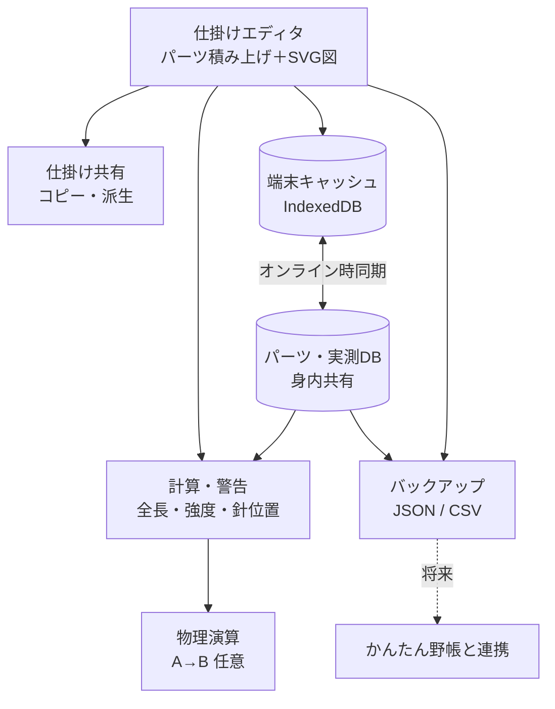

# tackle-lab 仕様書

釣りの仕掛けを設計するスマホ向けPWA。作業ルールはリポジトリ直下の `CLAUDE.md`。

- 版：0.1（たたき台。まだ実装なし）
- Claude が仮に決めたこと・未確認の数値には【要確認】を付けている

## 1. 概要

- 仕掛けを **パーツの積み上げ** で組み立て、**SVG図** と **強度・長さの自動計算** を出す
- パーツの **公開スペック／実測値DB** を **身内で共有**（ログインなし・名前入力のみ）
- 物理演算（潮受け・たるみ）は **比較用ツール** と割り切り、余裕があれば作る
- 釣果記録は **対象外**。将来「かんたん野帳」と連携するときに、リファクタリングとセットで考える

### 1.1 目的

- 仕掛けの設計・比較・改良を、図と数値でやりやすくする
- 強度計算の精度を、メーカー公表値と身内の実測値で上げていく

### 1.2 スコープ

| 機能 | 優先度 | フェーズ |
|---|---|---|
| 仕掛けエディタ＋SVG図 | 高 | 1 |
| パーツDB＋計算・警告 | 高 | 2 |
| 共有DB・同期・バックアップ | 中 | 3 |
| 仕掛けの共有・コピー派生 | 中 | 4 |
| 物理演算 | 低（任意） | 5 |

対象外：釣果記録・ポイント情報・写真

## 2. 仕掛けエディタ

- パーツを上から順に積む（例：道糸 → サルカン → 幹糸 → 枝ス＋針 → 捨て糸 → オモリ）
- 構成タイプ：胴付、天秤、捨てオモリ式 など
- 入力から **SVG仕掛け図を自動生成**
- 仕掛けは **パーツの配列（JSON）** として持つ。図・計算・書き出し・将来の連携の共通の土台にするため
- 各仕掛けに **UUID**（変わらないID）を振る。名前は変わることがあるので、連携や派生の記録はIDで行う

### 2.1 仕掛けのデータの形

```json
{
  "schemaVersion": 1,
  "id": "UUID",
  "name": "アマダイ胴付き 2本針",
  "type": "dozuki",
  "memo": "",
  "derivedFrom": null,
  "createdAt": "2026-11-09T04:00:00.000Z",
  "updatedAt": "2026-11-09T04:00:00.000Z",
  "parts": [ /* 上から順のパーツ（2.2） */ ]
}
```

| 項目 | 意味 |
|---|---|
| `schemaVersion` | データの形の版。形を変えたときに古いデータを読み替えるため |
| `id` | 仕掛けの UUID |
| `name` | 名前 |
| `type` | 構成タイプ：`dozuki`（胴付）／`tenbin`（天秤）／`sute`（捨てオモリ式）／`other` |
| `memo` | メモ |
| `derivedFrom` | コピー元の仕掛けの `id`。コピーでなければ `null` |
| `createdAt` / `updatedAt` | 作った日時・最後に変えた日時（ISO 形式） |
| `parts` | パーツの配列。**上（竿側）から下（オモリ側）の順** |

- 仕掛けを作る人の名前（入力者）は、共有を始める Phase 3 で足す【要確認】

### 2.2 パーツ

仕掛けの「軸」（竿からオモリまで一直線につながる部分）を上から順に並べる。枝スは軸から横に出るパーツとして、軸の途中に置く。

すべてのパーツに共通の項目

| 項目 | 意味 |
|---|---|
| `id` | パーツの UUID（並べ替えや画面の部品の区別に使う） |
| `kind` | 種類（下の表） |
| `length` | 軸の方向の長さ（cm）。枝スは軸の上で場所を取らないので 0 |
| `color` | 色（任意） |
| `memo` | メモ（任意） |
| `productId` | 製品DBの ID。Phase 2 で使う。それまでは `null` |

種類ごとの項目

| `kind` | 意味 | 追加の項目 |
|---|---|---|
| `line` | 糸 | `role`（道糸 `michi`／幹糸 `mikiito`／ハリス `harisu`／捨て糸 `sute`／その他 `other`）、`material`（ナイロン `nylon`／フロロ `fluoro`／PE `pe`）、`gou`（号数） |
| `connector` | 金具・小物 | `subtype`（サルカン `swivel`／三又サルカン `triSwivel`／スナップ `snap`／ビーズ `bead`／クロスビーズ `crossBead`／その他 `other`）、`size`（号数などの文字） |
| `branch` | 枝ス＋針 | `line`（`material`・`gou`・`length`）、`hook`（`name`・`size`） |
| `hook` | 軸の先の針（天秤など） | `name`、`size` |
| `sinker` | オモリ | `weight`（号。1号＝3.75g） |
| `other` | その他 | `name` |

- 長さの単位は cm にそろえる。釣りでは m と cm が混ざるが、計算のときの換算まちがいを防ぐため
- 金具の長さは、入れなければ 0 として扱う（全長への影響が小さいため）
- 長さにマイナスや数字でない値が入ったら、計算では 0 として扱う

### 2.3 長さの計算

- **全長**：軸のパーツの `length` の合計（枝スは含めない）
  - 道糸（`role` が `michi` の糸）は全長と位置の計算から外す。道糸はリールから出る何百mもの糸で、仕掛けの長さとは別に考えるため【要確認】
- **パーツの位置**：上の端からの距離と、下の端からの距離
- **底からの高さ**：枝スの付け根が、オモリの上端からどれだけ上にあるか
  - 船の胴付き・捨てオモリでは、オモリが底に着くので「底から何cm上に針があるか」が大事なため
  - オモリがないときは、軸のいちばん下の端から測る
  - オモリが2つ以上あるときは、いちばん下のオモリの上端から測る【要確認】
- **針先の高さの目安**：底からの高さ − 枝スの長さ（0 より下にはしない）
  - 枝スがまっすぐ垂れたとしたときの値。実際は潮で流れるので目安【要確認：表示の言い方】
- **枝スの間隔**：となり合う枝スの付け根どうしの距離（上から順）

## 3. 計算・警告

- 全長、枝スの間隔、オモリからの針の位置
- 号数 → 強度（kg / lb）換算
- **結束強度**（ノットによる強度の低下）を考慮した実効強度
  - 結束強度は元の強度のおよそ6〜9割【要確認：ノット別の数値を文献・実測で確かめる】
- 最弱点の表示と警告
  - 例：捨て糸がハリスより強い → 根掛かりのとき仕掛けごと切れる
- 竿の長さに対して仕掛けが長すぎないかのチェック【要確認：判定の基準】

## 4. パーツ・実測DB

値は「誰が・何を根拠に」とセットで持つ。

| 項目 | 例 |
|---|---|
| 製品 | ○○フロロ 4号 |
| 値の種類 | 直径 / 強度 / 比重 / 線径 |
| 値 | 0.330mm |
| 出典 | メーカー公表 / 実測 |
| 測定条件 | ノット名、試行回数 |
| 入力者 | 名前 |
| 日付 | 2026-11-09 |

- 実測は **1回の測定＝1行** で追加し、平均・n・標準偏差を集計して出す
- 計算に使う値（公表値／実測平均）を切り替えられる
- 線径・比重は主に沈下・潮受けの計算に使う。強度は主に結束強度で決まる

## 5. 共有・権限

- **ログインなし**。名前を入力するだけ。一度入れた名前は端末に覚えて、表記ゆれを防ぐ
- 共有するもの：パーツのスペック・実測値、仕掛け
- 上書き・削除は **許可**（安全策は6章）
- URLが外に漏れたときに備えて **合言葉** を後から足せる作りにする【要確認：最初から入れるか】
  - 公開リポジトリなので、合言葉をコードに直接書くと誰でも読める。入れるときは置き場所を考える【要確認】

## 6. 安全策

### 6.1 確認ポップアップ

| 操作 | 表示する内容 |
|---|---|
| 新規保存 | 追加する内容 |
| 上書き | 変更前 → 変更後の比較 |
| 削除 | 対象名と件数 |
| まとめて削除 | 対象名を入力しないと実行できない |

- 「本当に〜しますか？」だけだと読まずに押すクセがつくので、**何が変わるかを必ず出す**
- 削除の直後に数秒「元に戻す」ボタンを出す

### 6.2 バックアップ／復元

- 書き出し
  - **JSON**：復元用（欠けなく残せる）
  - **CSV**：閲覧用（Excel・スプレッドシート）
- 仕掛け1つだけをJSONで書き出すこともできる（将来の野帳連携用）
- 復元は「全部置き換え」か「足りない分だけ追加」を選ぶ。共有DBで他の人の最新入力を消さないため
- 「最後のバックアップから○日」のリマインドを出す【要確認：何日で出すか】
- アプリを開いたとき、端末に自動で控えを残す

## 7. 仕掛けの共有・派生

- 身内に公開する
- 他の人の仕掛けを **コピーして改造（派生）** できる
- 派生元のIDを記録し、系譜をたどれるようにする

## 8. 物理演算（任意）

| レベル | 内容 | 難易度 |
|---|---|---|
| A | パーツごとの潮の抵抗と沈む力の比較 | 低 |
| B | 2Dの静的つり合い（ランプドマス法） | 中 |
| C | 時間変化つきシミュレーション | 高 |

- A → B を目標にする。C はやらない
- 水深ごとの潮の速さは分からないので、**結果は相対比較用**
- 抗力係数などは文献値で仮置きし、実測で補正する【要確認：文献値】
- 重い計算は Web Worker（画面の裏で計算させる仕組み）で動かし、画面が固まらないようにする

## 9. 技術構成

| 役割 | 使うもの |
|---|---|
| 画面 | React + Vite |
| 図 | SVG |
| 端末保存 | IndexedDB（Dexie.js） |
| 共有DB | Supabase か Cloudflare D1【要確認】 |
| 試験 | Vitest |
| 重い計算 | Web Worker |
| ビルド・公開 | GitHub Actions → GitHub Pages |
| 形態 | PWA |

- 船の上でも使えるように、端末に保存しておき、電波が戻ったら共有DBと同期する
- 公開先は GitHub Pages。リポジトリが公開なので無料で使える
- URL は https://thirabayashitools-ux.github.io/tackle-lab/ 。カスタムドメインは使わない
  - 理由：身内用ならURLの長さは困らない（ホーム画面に追加すれば使える）。費用と管理の手間もかからない
  - 注意：端末保存（IndexedDB）とホーム画面のアプリはURLのドメインごとに分かれる。あとでドメインを変えると、端末のデータはバックアップの書き出し→読み込みで移す必要がある
- Supabase の無料版は、一定期間アクセスがないと止まる【要確認：期間と、止まったときの戻し方】
- 各サービスの無料枠（DB容量など）【要確認】



## 10. フェーズ

GitHub のマイルストーン `Phase 1`〜`Phase 5` と対応する。

1. 仕掛けエディタ＋SVG図（端末保存のみ）
2. パーツ・実測DB＋強度計算
3. 共有DB・同期・確認ポップアップ・バックアップ
4. 仕掛けの共有（コピー・派生）
5. 物理演算 A → B
