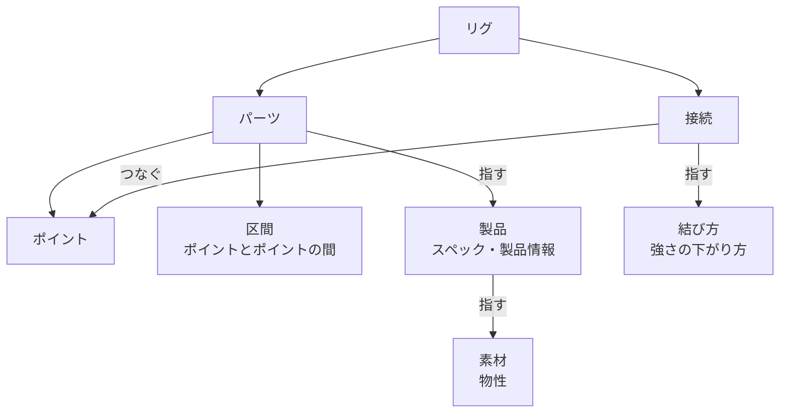
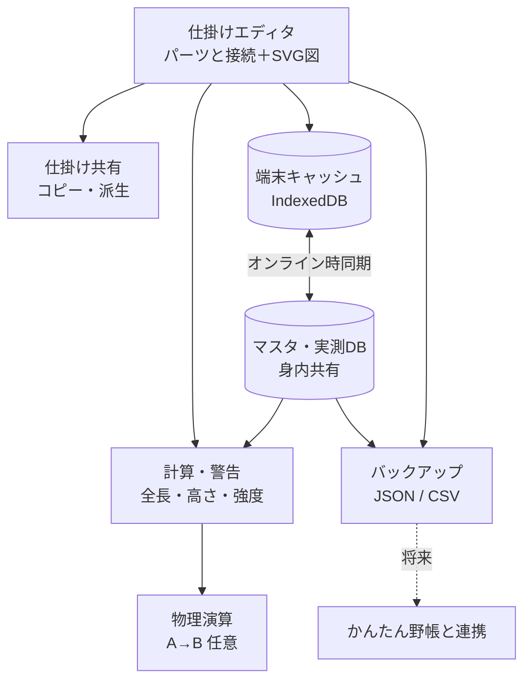

# tackle-lab 仕様書

釣りの仕掛けを設計するスマホ向けPWA。作業ルールはリポジトリ直下の `CLAUDE.md`。

- 版：0.1（たたき台。まだ実装なし）
- Claude が仮に決めたこと・未確認の数値には【要確認】を付けている

## 1. 概要

- 仕掛けを **パーツを接続でつないで** 組み立て、**SVG図** と **強度・長さの自動計算** を出す
- パーツの性質（製品のスペック・素材の物性・実測値）を **マスタ** として **身内で共有**（ログインなし・名前入力のみ）
- 物理演算（潮受け・たるみ）は **比較用ツール** と割り切り、余裕があれば作る
- 釣果記録は **対象外**。将来「かんたん野帳」と連携するときに、リファクタリングとセットで考える

### 1.1 目的

- 仕掛けの設計・比較・改良を、図と数値でやりやすくする
- 強度計算の精度を、メーカー公表値と身内の実測値で上げていく

### 1.2 スコープ

| 機能 | 優先度 | フェーズ |
|---|---|---|
| 仕掛けエディタ＋SVG図 | 高 | 1 |
| マスタ・実測DB＋計算・警告 | 高 | 2 |
| 共有DB・同期・バックアップ | 中 | 3 |
| 仕掛けの共有・コピー派生 | 中 | 4 |
| 物理演算 | 低（任意） | 5 |

対象外：釣果記録・ポイント情報（釣り場の情報）・写真

### 1.3 用語

画面・仕様書・コードで同じ言葉を使う。コード上の名前もこの表に合わせる。

| 呼び方 | コード上の名前 | 意味 |
|---|---|---|
| リグ | `rig` | 1つの仕掛け。保存・コピー（派生）・書き出しの単位。道糸・リーダーもリグのパーツとして入れる |
| タックル | `tackle` | 竿（とリール）。リグとは別の物として考えるが、しばらく作らない（2.5） |
| パーツ | `part` | リグを作る1つ1つの物。糸（幹糸・ハリス・枝ス・捨て糸など）も、金具・小物（サルカン・オモリ・針・天秤・ビーズ・うき止めなど）も、すべてパーツ。ポイントと区間でできている |
| ポイント | `point` | パーツの上の「何かがある所」。パーツの始まりからの位置を持つ（2.2） |
| 区間 | `section` | パーツの中の、ポイントとポイントの間。伸び率・破断強度などの性質を持つ（2.2） |
| 接続 | `joint` | 2つのパーツのポイントをつなぐもの（結束・連結・通し）、または相手のいない結び目（玉留めなど）。パーツではない。強さの下がり方を持つ |
| マスタ | （まとめた呼び名） | パーツや接続の性質の元になる表。製品・素材・結び方の3つ（2.2） |
| 製品 | `product` | マスタの1つ。パーツが指す物（例：フロロ 3号（標準）、○○フロロ 3号、オモリ 80号）。スペックと製品情報を持ち、素材を指す |
| 素材 | `material` | マスタの1つ。フロロ・ナイロン・PE・真鍮・鉛など。物性を持つ |
| 結び方 | `knotStyle` | マスタの1つ。クリンチノット・FGノットなど。素材ごとの強さの下がり方を持つ |
| レイアウト | `layout` | 図の上でのパーツの置き方と描き方（角度・色など）。計算には使わない |

- 「ピース」「ライン」という言葉は使わない。糸も金具もパーツとして同じ作りにしたため
  - 理由：糸と金具の違いは、区間の性質（伸びやすさ・曲がりやすさ・強さ）の違いとして表せる。計算は性質だけを見るので、糸かどうかを分ける必要がない（2.1）
- 「糸」「金具」は、ふだんの言葉として使ってよい。データでの区別はパーツの種類（`kind`）で、画面のためだけに使う
- 「仕掛け」はリグと、「部品」はパーツと同じ意味で、ふだんの言葉として使ってよい。「オブジェクト」は JavaScript の言葉と紛れるので使わない
- 図の上の色はレイアウトに持たせる。入れなければ種類と素材ごとに決まった色で描く（例：フロロとナイロンで色を変える）。実物の色は計算に使わないので、製品の製品情報に書く

向きと荷重

- 「上・下」という言い方は使わない。考えるのは力がかかる向きだけにする。つながり（どのパーツが何につながっているか）と、海の中での向きを混ぜないため

| 用語 | 意味 | 何に使うか |
|---|---|---|
| タックル側 | つながりをたどって、タックルに近づく向き | 構造の基本。どのポイントからも、タックルへの道は1本に決まる |
| 先側 | タックル側の反対。タックルから遠ざかる向き | 分かれた先をたどるとき（「先糸」の「先」） |
| 重力の向き | オモリなどの重さがかかる向き | 物理演算（Phase 5）。模式図では下向きに描く |
| 荷重の向き | 魚や根掛かりで引かれる向き | 強度計算（3章） |

- **経路**：2つのポイントの間の道すじ。パーツの中は区間を、パーツとパーツの間は接続を通る。リグの中に輪はないので、1本に決まる
  - **経路の長さ**：経路の上の区間の長さの合計。接続は長さを持たない（2.3）
- **分岐点**：3つ以上の向きに経路が分かれるポイント（エダス結びの所、三又サルカン・天秤の付け根など）
- **荷重点**：荷重がかかる所。魚が掛かった針、根掛かりしたオモリや針など
- **荷重経路**：荷重点からタックルまでの経路。荷重はこの経路の上の区間と接続にだけかかる
  - 3章の最弱点は、荷重点ごとに、その荷重経路の中でいちばん弱い所を探す
  - 例：オモリが根掛かりしたとき、荷重経路の中で捨て糸がいちばん弱ければ、捨て糸だけ切れて仕掛けが残る
- **先端**：そこから先側に何もつながっていないポイントで、魚や重力による引っ張りが始まる所（針、捨て糸の先のオモリの端など）
  - ビーズのように、通しで糸の途中に乗っているだけのパーツは先端ではない。糸に沿った両側がつながっているため
- 「軸」「枝」という用語は作らない。樹木でいちばん長い先端が幹ではなく枝であるように、特別な一本を決めても計算の役に立たないため。計算は「どこからどこまでの経路か」で考える
  - 「幹糸」「枝ス」「ハリス」などは、パーツの呼び名（`role`）として残す。画面に出すだけで、計算では見ない
- リグの中に **輪はない**（ぐるっと回って元に戻るつながりはない）ものとする。輪になる仕掛けはほぼないため。これで、タックルへの道がどのポイントからも1本に決まる
  - チチワ（糸の端に作る小さい輪）は、糸のポイント1つ（形が環）として扱うので、輪には当たらない
- 未定義【要確認】
  - 通しの力の伝わり方。通しのパーツにも力はかかる（中通しオモリの重さ、誘導パーツにかかる糸と垂直に近い力、ストッパーが受ける力）。荷重経路をどこまで単純にたどるかは 3章を詰めるときに決める

接続の種類

| 呼び方 | コード | 例 | 計算への影響 |
|---|---|---|---|
| 結束 | `knot` | クリンチノット、FGノット、エダス結び、玉留め | 結び目の所で、つないだ糸がそれぞれ弱くなる（強さの下がり方は 2.2 の接続）。ずれない |
| 連結 | `link` | スナップにサルカンを付ける、天秤の腕に付ける（環と環を掛け合わせる） | 金具の強さで決まる。ずれない |
| 通し | `slide` | ビーズ・中通しオモリ・うき止め・ゴム管に糸を通す。ハリス止め・ガン玉に糸を挟む | ずれられる範囲と、動きにくさを持つ（動きにくさの項目は将来の候補。2.2） |

- 接続には相手のパーツがいなくてもよい。玉留めは、糸の途中にある相手のいない結束
  - 結び目なので、そこで糸が弱くなる（3章の最弱点に出る）
- 通しの動きにくさは「ずれ始める力」（kg。3章の強度に単位をそろえる）。データに入れるのは将来（2.2 の「将来の候補」）
  - 0 なら自由に動く（ビーズ・中通しオモリ）、大きいほど動きにくい（うき止め・ゴム管・ハリス止め）。分からなければ空欄
  - 「止める」は「動きにくい通し」と考えるので、別の種類にしない。うき止めのように、一定の力でずれる仕組みもそのまま表せる
  - 通しのパーツは、両側にある物（玉留め・サルカン・うき止めなど）に当たって止まる。「止めておく働き」は種類としては持たない
  - Phase 1〜4 の長さ・高さの計算では、エディタで置いた位置にあるものとして扱う。ずれるか・当たって止まるかの計算は物理演算（Phase 5）
  - 実際の数値は実測でしか分からないので、4章の実測DBに入れられるようにする【要確認】
- ガン玉など、挟んだ所で糸が傷んで弱くなる通しには、結束のような「強さの下がり方」も持てるようにする（将来の候補。2.2）
- 糸のループ（チチワなど）も、サルカンのカンやスナップの輪も、同じ **環** として扱う。連結は「環と環をつなぐ」こと。ループを作る結び目そのものは、玉留めと同じく相手のいない結束としてそのポイントに付く

## 2. 仕掛けエディタ

- パーツを接続でつないで組み立てる。分かれた形（胴付きの枝ス、天秤など）もそのまま作れる
  - よく使う組み合わせはまとめて足せるようにする（例：「枝スを追加」で、枝ス・針・エダス結び・外掛け結びの4つを作る）。データは細かくても、入力の手間は増やさないため
- 道糸・リーダーは仕掛けのパーツとして入れ、付け替えはエディタの中でする。竿は仕掛けに入れない（タックルは 2.5。しばらく作らない）
- 入力から **SVG仕掛け図を自動生成**
- 仕掛けは **パーツと接続（JSON）** として持つ。図・計算・書き出し・将来の連携の共通の土台にするため
- 各仕掛けに **UUID**（変わらないID）を振る。名前は変わることがあるので、連携や派生の記録はIDで行う
- 胴付き・天秤などの「構成タイプ」は持たない。つながりから分かるので、持つと同じ情報を2か所に持つことになるため（例：「胴付き」なのに天秤が入っている）

### 2.1 データの決まり

#### 項目は、それを使う計算か画面ができるときに足す

- 今のデータに入れるのは、エディタと長さの計算に要る最低限だけ
- 理由：使わない項目を先に入れると、意味が使ってみるまで確かめられず、あとで中身がずれる。実物の仕掛けは立体で、潮やたるみで毎回違うので、厳密にしすぎても実釣とのずれは消えず、入力が面倒になるだけ
- `schemaVersion` があるので、あとから足しても古いデータは読み替えられる
- 考え方が決まっていてまだ入れない項目は、2.2 の最後の「将来の候補」に書く

#### 設計のデータは、つながりと長さで持つ

- リグのデータは「どのパーツが何につながっているか（接続）」と「パーツの上の位置（cm）」で持つ。リグ全体の2Dの座標は、設計のデータに入れない
- 理由
  - 釣り人が決めるのは長さとつながり（「幹糸110cm、40cmの所に枝ス」）。糸の角度や形は潮・張り具合で毎回変わるので、設計の入力ではなく物理演算（8章）の結果
  - 座標を正本にすると、座標からも長さが出るので、同じ情報を2か所に持つことになる。図の点を動かしただけで糸の長さが変わってしまう
- 図の上の置き方（角度など）はレイアウトに持ち、計算には使わない（1.3）
- 天秤・三又サルカンのような、形が決まっていて曲がらないパーツは、**そのパーツの中だけの2D座標** で形を持つ（腕の長さ・角度など、実物で決まっている形）。糸は長さだけ
  - 入れるのは、それを使う図か物理演算ができたとき【要確認：持ち方は、そのときに決める】

#### 計算は、区間とポイントの性質だけを見る

- 計算（長さ・強度・物理演算）は、区間の性質（伸び率・破断強度・曲がりやすさなど）とポイントの位置・形、接続だけを見る。パーツの種類（`kind`）や呼び名（`role`）は見ない
  - 例：ハリスの区間は伸びやすく曲がりやすい。金属の区間は伸び率 0 で強い。物理演算で区間を細かく区切るかどうかも、曲がりやすさで決まる
- 種類と呼び名は、画面（入力欄・絵・表示名）と、性質の最初の値を選ぶためだけに使う
- 理由：「幹糸・枝スは計算で特別扱いしない」（1.3）を、すべてのパーツに広げたもの。種類で計算を分けると、種類が増えるたびに計算を直すことになる

#### 性質の数字は、マスタから引く

- リグに書くのは、選んだもの（製品・結び方）だけ。伸び率などの数字はマスタから引く
- 自分で数字を変えたときだけ、その値をリグに書く（上書き。項目は将来の候補）
- 理由：同じフロロ3号なら、どのリグでも同じ数字。リグごとに書くと何十か所にもなり、マスタの値を直しても作ったリグに反映されない

#### 物理演算（ランプドマス法）との対応

- データの形は、ランプドマス法（糸を、重さを持つ点をバネでつないだものとして計算する方法）にほぼそのまま当てはまるように作る

| データ | ランプドマス法 |
|---|---|
| ポイント | 節点（重さを持つ点） |
| 区間 | バネ（自然長はポイントの位置から出す） |
| 区間の物性・スペック（太さ・伸び率など）、パーツの重さ・比重 | バネの硬さ・潮の抵抗、節点の重さ・浮力 |
| 結束・連結 | 2つのパーツのポイントを同じ節点にする |
| 通し | 糸に沿って動ける節点（普通のランプドマス法にはないので、足して作る） |
| 曲がらないパーツの角 | 曲げのバネ |

- 糸はデータでは細かく区切らない。計算するときだけ自動で細かく区切る（区切らないと、点と点の間がまっすぐになってしまうため）
- 回転（サルカンなど）は描かない。要るようになったら、パーツごとに回転のしにくさのデータを足す
- 環の中の遊びも、通しと同じ「ずれられる範囲」として扱う（2.2 の「将来の候補」）

### 2.2 データの形



#### リグ

```json
{
  "schemaVersion": 2,
  "id": "UUID",
  "name": "アマダイ胴付き 2本針",
  "memo": "",
  "derivedFrom": null,
  "tackleSide": { "part": "UUID", "point": "a" },
  "lengthStart": null,
  "lengthEnd": null,
  "bottom": null,
  "createdAt": "2026-11-09T04:00:00.000Z",
  "updatedAt": "2026-11-09T04:00:00.000Z",
  "parts": [],
  "joints": [],
  "layout": {}
}
```

| 項目 | 意味 |
|---|---|
| `schemaVersion` | データの形の版。形を変えたときに古いデータを読み替えるため。この形は 2 |
| `id` | 仕掛けの UUID |
| `name` | 名前 |
| `memo` | メモ |
| `derivedFrom` | コピー元の仕掛けの `id`。コピーでなければ `null` |
| `tackleSide` | タックル側の端（道糸を入れたときは、道糸の竿側の端）。どのパーツのどのポイントか。向き（タックル側・先側）は、ここからつながりをたどって決まる |
| `lengthStart` | 全長の起点。どのパーツのどのポイントか。`null` なら `tackleSide`（2.3） |
| `lengthEnd` | 全長の終点。どのパーツのどのポイントか。`null` なら起点からいちばん遠い先端（2.3） |
| `bottom` | 底の起点（底に着くオモリの端）。どのパーツのどのポイントか。自分で選ぶ。`null` ならまだ選んでいない（2.3） |
| `createdAt` / `updatedAt` | 作った日時・最後に変えた日時（ISO 形式） |
| `parts` | パーツの並び。並び順に意味はない（つながりは接続で表すため） |
| `joints` | 接続の並び。並び順に意味はない |
| `layout` | 図の上の置き方と描き方。#3（エディタ）を作るときに中身を決める |

- 仕掛けを作る人の名前（入力者、`author`）は、共有を始める Phase 3 で足す
  - 理由：Phase 2 までは端末に保存するだけで、作った人は必ず自分なので使い道がない。`schemaVersion` があるので、あとで足しても古いデータを読み替えられる
  - 他の人の仕掛けをコピー（派生）したときは、コピーした人の名前になる。元の作者は `derivedFrom` をたどって分かる
- パーツ・接続の `id` も UUID にする。ポイントの `id` は、そのパーツの中で重ならなければよい（`a`・`start` など短い名前）

#### パーツ

| 項目 | 意味 |
|---|---|
| `id` | パーツの UUID |
| `kind` | 種類：糸 `line`／針 `hook`／オモリ `sinker`／サルカン `swivel`／三又サルカン `triSwivel`／スナップ `snap`／天秤 `tenbin`／ビーズ `bead`／その他 `other` など。画面と最初の値のためだけに使う（2.1） |
| `role` | 呼び名（なくてもよい）：幹糸 `mikiito`／枝ス `edasu`／ハリス `harisu`／捨て糸 `sute`／リーダー `leader`／その他 `other`。画面に出すだけ |
| `product` | 製品の id（マスタ）。なくてもよい |
| `points` | ポイントの並び |
| `memo` | メモ（なくてもよい） |

- 種類は、必要になったら足してよい（足しても計算は変わらないため）
- `product` が空のときは、性質を使う計算（強度など）でそのパーツを「分からない」として扱い、警告を出す。Phase 1 の長さの計算には性質を使わないので、空でも困らない【要確認】
- 素材は製品を通して決まるので、パーツに素材の欄は持たない。1つのパーツの中に別の素材の区間がある（天秤の腕と本体など）ときは、その区間だけ上書きする（将来の候補）
- 曲がらないパーツのポイント（オモリの環と下端など）は、パーツを足すときに製品の形から写して作る。あとから製品の形を変えても、作ったリグのポイントは変わらない【要確認】
  - 理由：接続はポイントの `id` を指している。製品の側でポイントが増減すると、リグの接続が切れてしまうため

#### ポイント

| 欄 | 中身 | なくてもよいか |
|---|---|---|
| `id` | パーツの中での名前 | 必ずある |
| `at` | 位置（cm）。パーツの始まりからの距離 | 必ずある |
| `to` | 幅の終わり（cm）。幅は `at`〜`to` | なければ幅のない点 |
| `form` | 形：環 `ring`（糸のループ、サルカンのカン、スナップの輪など）／穴 `hole`（中通しオモリ・ビーズ） | なければ形のない場所（糸の上など） |

- 位置（`at`・`to`）と形（`form`）は別の欄にする。1つのポイントが両方を持つことがあるため（例：チチワは、幹糸の上では 110cm の点で、形は環）
- 点のときに `to` を書かないのは、同じ数字を2か所に持たないため
- 例：`{ "id": "e1", "at": 40 }`（点）、`{ "id": "slide", "at": 40, "to": 60 }`（幅）、`{ "id": "a", "at": 0, "form": "ring" }`（環）
- 位置は、パーツの **始まりからの距離** で持つ
  - 理由：前のポイントからの距離で持つと、前のポイントに幅があるとき、どこから測るかが決まらない。また、1つ動かすと先のポイントが全部動いてしまう
- **パーツの長さは、ポイントの位置のいちばん大きい値**（`at` と `to` のうち大きいほう）。長さの欄を別に持たない（同じ数字を2か所に持たないため）
  - 終わりのポイントに幅があるとき（ハリスの先の外掛け結びなど）は、幅の終わりまでが長さになる【要確認：使ってみて決める】
- 糸を途中で2つのパーツに分けない。幹糸1本の途中にエダス結びがある、などは、1本の糸のポイントで表す
  - 理由：実物の作り方に近い。遊動の範囲（ポイントの幅）も表せる
- 位置を入れなければ 0 として扱う。サルカンの環と環の間など、小さい金具の長さは全長への影響が小さいため
  - オモリは長いものもあり、底からの高さ（2.3）に効くので、下端のポイントの位置を入れることをすすめる
- 位置にマイナスや数字でない値が入ったら、保存はできるが、計算では 0 として扱い、警告を出す
- 枝分かれのあるパーツ（天秤・三又サルカン）の中の長さは、2D座標を入れるまで 0 として扱う【要確認：1本の物差しでは枝分かれを表せないため】

ポイントの幅の意味

ポイントの幅（`at`〜`to`）の意味は、そこに付く接続の種類で決まる。

| 接続 | 幅の意味 |
|---|---|
| 結束（ふつうの結束・玉留め・チチワなど） | 幅なし |
| 結束（摩擦系の結束・外掛け結びなど） | 結び目が **占める範囲**。外掛け結びなら、針のポイントにも範囲がある（針の上で結び目が巻かれる所） |
| 通し | パーツが **動ける範囲**（遊動の範囲） |
| 連結 | 幅は使わない。遊びは下の「将来の候補」 |

- 環の中の遊び（つないだ環と環の間でずれる分）も「ずれられる範囲」だが、ポイントの幅には入れない
  - 理由：幅は設計する人が決める（うき止めの位置など）。遊びは金具の内径で決まるので、データに持つと同じ情報を2か所に持つことになる。形 `ring` と製品の内径から計算する

画面での入力と表示

- 仕掛けの設計では「エダスとエダスの間が何cm」と考えることが多いので、途中にポイントがある糸（幹糸など）は「前のポイントから何cm」で入れる・見る。保存するときに始まりからの距離に直す
- 途中にポイントがない糸（ハリスなど）は「長さ 30cm」として入れる。中身は終わりのポイントの位置
- 糸を作るときは、始まり（`start`、`at` 0）と終わり（`end`）のポイントを必ず作る。どちらも消せない
- **間隔を変えたら、それより先のポイントはまとめてずれる**（ほかの間隔は変わらず、糸の長さが伸び縮みする）。エダスの間を詰めたとき、ほかのエダスどうしの間隔が崩れないようにするため
- 幅のあるポイントがあるときの間隔は、「前のポイントの終わりから、このポイントの始まりまで」とする【要確認：遊動の範囲で使ってみて決める】

#### 区間

- 区間は、パーツの中の **となり合うポイントとポイントの間**。データには書かず、ポイントの位置から決まる
  - 例：幹糸のポイントが 0・40・100・110 なら、区間は 0〜40・40〜100・100〜110 の3つ
  - 理由：区間を別に書くと、ポイントを足したり動かしたりするたびに区間も直すことになるため
- 区間の長さは、両端のポイントの位置の差
- 区間の性質（伸び率・破断強度・曲がりやすさなど）は、パーツの製品（とその素材）から引く。区間ごとの上書きは将来の候補
- 枝分かれのあるパーツの区間は、2D座標を入れるときに、どのポイントとどのポイントの間かを書く形にする【要確認】

#### 接続

```json
{ "id": "UUID", "type": "knot", "knotStyle": "clinch",
  "ends": [ { "part": "UUID", "point": "b" }, { "part": "UUID", "point": "start" } ] }
```

| 項目 | 意味 |
|---|---|
| `id` | 接続の UUID |
| `type` | 種類：結束 `knot`／連結 `link`／通し `slide`（1.3） |
| `knotStyle` | 結び方の id（マスタ）。結束のときだけ |
| `ends` | つなぐ相手（どのパーツのどのポイントか）。ふつうは2つ。相手のいない結束（玉留め・ループを作る結び目）は1つ |

- 接続はパーツの中に入れず、リグの中に別の並び（`joints`）として持つ
  - 理由：結束・連結は2つのパーツのポイントを同じ節点にするもので、どちらのパーツにも属さないため（2.1 の「物理演算との対応」）
- `ends` の順番に意味はない。向きは `tackleSide` からたどって決まるため
- 結束による **強さの下がり方**（元の強さの何%になるか）は、接続の両端（`ends` の1つずつ）に持つ。最初の値は結び方マスタ（結び方 × 素材 → %）から引き、変えたときだけ書く（項目は将来の候補）
  - 理由：1つの結び目が、2本の糸をそれぞれ違う割合で弱める（FGノットの PE 側とリーダー側など）。ポイントに持たせると、結び方を変えたときに古い値が残る
- 結び方を自由な文字で書かず、マスタの id にするのは、強度の計算で書き方の揺れ（「クリンチ」「クリンチノット」など）が出ないようにするため

#### マスタ

性質の数字の元になる表。リグは id で指すだけにして、数字はここから引く（2.1）。

| マスタ | 持つもの | 例 |
|---|---|---|
| 素材 | **物性**：素材で決まり、区間ごとに効くもの（伸び率・比重など） | フロロ、ナイロン、PE、真鍮、鉛 |
| 製品 | **スペック**：その物1つで決まるもの（重さ、パーツ全体での破断強度、太さ、内径など）。**製品情報**：計算に使わないもの（メーカー・色など）。素材を指す | フロロ 3号（標準）、○○フロロ 3号、オモリ 80号（標準） |
| 結び方 | 素材ごとの強さの下がり方（%） | クリンチノット、FGノット、エダス結び |

- 「一般的な値」も製品の1つとして持つ（**標準の製品**。例：フロロ 3号（標準））。メーカーの製品と同じ形
  - 理由：Phase 1 は製品を選ばずに「フロロ 3号」と入れるだけのことが多い。標準の製品を指しておけば、あとでメーカーの製品に切り替えるときも、指す先を変えるだけで済む
- 標準の製品・素材・結び方の一覧は、アプリに最初から入れておく（Phase 1 から使う）。共有DBで増やすのは Phase 2 から（4章）
- 糸の破断強度は、素材の物性から計算せず、製品のスペックとして持つ。同じ号数でもメーカーで強さがかなり違い、4章でも製品ごとに公表値・実測値を集めるため
- Phase 1 の製品が持つのは、名前・合う種類・素材・号数かサイズだけ。オモリの重さは号数から出す（1号＝3.75g）
- 物性・スペックの細かい項目（伸び率・曲がりやすさなど）は、それを使う計算ができたときに足す（2.1）
- 標準の製品の id は、読める固定の名前にする（例：`std-fluoro-3`）【要確認】

#### 例：アマダイ胴付き 2本針

実物の仕掛け（タックル側から）

- サルカン（環が2つ。環 a に道糸・リーダーを結ぶ。この例では道糸・リーダーを入れていない）
- 幹糸 フロロ5号 110cm。40cm と 100cm の所にエダス結びで枝ス
- 枝ス フロロ3号 30cm ×2、先に外掛け結びで針
- 幹糸の先に、電車結びで捨て糸 ナイロン3号 50cm
- 捨て糸の先に、オモリ 80号（長さ 5cm、環が1つ）

```json
{
  "schemaVersion": 2,
  "id": "rig-amadai",
  "name": "アマダイ胴付き 2本針",
  "memo": "",
  "derivedFrom": null,
  "tackleSide": { "part": "swv", "point": "a" },
  "lengthStart": null,
  "lengthEnd": null,
  "bottom": { "part": "snk", "point": "tip" },
  "parts": [
    { "id": "swv", "kind": "swivel", "product": "std-swivel-8",
      "points": [ { "id": "a", "at": 0, "form": "ring" }, { "id": "b", "at": 0, "form": "ring" } ] },
    { "id": "main", "kind": "line", "role": "mikiito", "product": "std-fluoro-5",
      "points": [ { "id": "start", "at": 0 }, { "id": "e1", "at": 40 },
                  { "id": "e2", "at": 100 }, { "id": "end", "at": 110 } ] },
    { "id": "br1", "kind": "line", "role": "edasu", "product": "std-fluoro-3",
      "points": [ { "id": "start", "at": 0 }, { "id": "end", "at": 30 } ] },
    { "id": "hook1", "kind": "hook", "product": "std-hook-amadai-12",
      "points": [ { "id": "tie", "at": 0 } ] },
    { "id": "br2", "kind": "line", "role": "edasu", "product": "std-fluoro-3",
      "points": [ { "id": "start", "at": 0 }, { "id": "end", "at": 30 } ] },
    { "id": "hook2", "kind": "hook", "product": "std-hook-amadai-12",
      "points": [ { "id": "tie", "at": 0 } ] },
    { "id": "sute", "kind": "line", "role": "sute", "product": "std-nylon-3",
      "points": [ { "id": "start", "at": 0 }, { "id": "end", "at": 50 } ] },
    { "id": "snk", "kind": "sinker", "product": "std-sinker-80",
      "points": [ { "id": "ring", "at": 0, "form": "ring" }, { "id": "tip", "at": 5 } ] }
  ],
  "joints": [
    { "id": "j1", "type": "knot", "knotStyle": "clinch",
      "ends": [ { "part": "swv", "point": "b" }, { "part": "main", "point": "start" } ] },
    { "id": "j2", "type": "knot", "knotStyle": "edasu",
      "ends": [ { "part": "main", "point": "e1" }, { "part": "br1", "point": "start" } ] },
    { "id": "j3", "type": "knot", "knotStyle": "sotogake",
      "ends": [ { "part": "br1", "point": "end" }, { "part": "hook1", "point": "tie" } ] },
    { "id": "j4", "type": "knot", "knotStyle": "edasu",
      "ends": [ { "part": "main", "point": "e2" }, { "part": "br2", "point": "start" } ] },
    { "id": "j5", "type": "knot", "knotStyle": "sotogake",
      "ends": [ { "part": "br2", "point": "end" }, { "part": "hook2", "point": "tie" } ] },
    { "id": "j6", "type": "knot", "knotStyle": "densha",
      "ends": [ { "part": "main", "point": "end" }, { "part": "sute", "point": "start" } ] },
    { "id": "j7", "type": "knot", "knotStyle": "clinch",
      "ends": [ { "part": "sute", "point": "end" }, { "part": "snk", "point": "ring" } ] }
  ],
  "layout": {}
}
```

（id は読みやすさのため短い名前にした。実際のパーツ・接続の id は UUID。`createdAt` などは省略）

計算の確かめ（2.3 の決まりで計算）

| 値 | 経路 | 結果 |
|---|---|---|
| 底の起点 | `bottom` で選んだ、オモリの `tip` | オモリの下端 |
| 全長 | 起点・終点とも `null` なので、サルカン a → いちばん遠い先端（オモリの下端）：0 ＋ 110 ＋ 50 ＋ 5 | 165cm |
| 枝ス1の付け根（`main` の e1）の高さ | オモリの下端から：5 ＋ 50 ＋（110 − 40） | 125cm |
| 枝ス2の付け根（`main` の e2）の高さ | 5 ＋ 50 ＋（110 − 100） | 65cm |
| 枝ス1・2の付け根の間隔 | `main` の上で 100 − 40 | 60cm |
| 枝スの長さ | 付け根から先端（針）まで：30 ＋ 0 | 30cm（高さとは別に並べて出す） |

- パーツ 8個・ポイント 16個・接続 7個。エディタでまとめて作る（2章の冒頭）ので、入力の手間は増やさない

#### 将来の候補（まだデータに入れない）

| 項目 | 置き場所 | 考え方 | 使う所 |
|---|---|---|---|
| 性質の上書き | パーツ（区間ごとの上書きも） | 自分で測った値など、マスタと違う数字を使いたいときだけ書く。天秤の腕と本体のように、1つのパーツに別の素材があるときもこれで表す | 3章の強度、物理演算 |
| 結束の強さの下がり方 | 接続の両端（%） | 最初の値は結び方マスタから引き、変えたときだけ書く | 3章の強度 |
| ポイントの「弱い所」 | ポイント | パーツそのものの弱い所（サルカンの環の付け根など） | 3章の最弱点 |
| 遊びのずれる長さ | 環のポイントの内径から計算 | 環と環の中でずれる分。アタリの伝わりやすさに直結するので無視できない。接続に直接入れず、製品の内径から出す【要確認：計算のしかた】。チチワは結んだ人が大きさを決めるので、ループの大きさを入れる欄が要りそう【要確認】。物理演算では、通しと同じ「ずれられる範囲」として扱う。考えるのは引っ張りの向きの遊びだけで、ほかの向きは無視する（問題になりにくいため）。範囲の出どころが違うだけ（通し＝ポイントの幅、遊び＝内径） | 3章の「アタリの伝わりやすさ」の目安（荷重経路の上の遊びの合計）【要確認】 |
| 折れ曲がり範囲 | 接続（度） | つながった2つのパーツが、どれだけ角度を変えられるか。環と環の連結はよく曲がり、摩擦結束は硬い | 図の角度（例：三又の角度をこの範囲の中でだけ動かす）、物理演算 |
| 動きにくさ（`holdForce`） | 通しの接続（kg） | 1.3 の「通し」を参照 | 物理演算 |
| 強さの下がり方（通し） | 通しの接続 | ガン玉など、挟んで糸が傷む分 | 3章の強度 |
| 回転のしにくさ | 製品のスペック | サルカンなど。2.1 の「物理演算との対応」 | 物理演算 |
| 曲がらないパーツの2D座標 | ポイント | 2.1 の「設計のデータは、つながりと長さで持つ」 | 図、物理演算 |

- 遊びのずれる長さは、全長や底からの高さには入れない（数mmの差は、潮やたるみのぶれの中に入るため）
- データの単位は cm にそろえ、画面では小さい値を mm で見せる。釣りでは m と cm が混ざるが、計算のときの換算まちがいを防ぐため

### 2.3 長さの計算

長さはすべて **経路の長さ**（1.3）で測る。

- 経路の長さは、通る区間の長さの合計。接続は長さを持たない（0）
- 幅のあるポイントまでの長さは、Phase 1〜4 では `at` で測る【要確認：遊動の範囲で使ってみて決める（エディタで置いた位置を別に持つか）】
- 道糸・リーダーも、ほかの糸と同じく計算に入る
- 道糸の長さ（出している長さ）は、水深などで毎回変わり、設計の長さではないので、入れなくてよい（入れなければ 0）【要確認：物理演算で出している長さが要るときに、入れ方を決める】

**全長**

- 全長の起点（`lengthStart`）から終点（`lengthEnd`）までの経路の長さ
- 起点と終点は、リグごとに自分で選ぶ。どこからどこまでを「全長」と見たいかは、仕掛けや人によって違うため
  - 起点の例：リーダーを含めた長さを見たいか、リーダーの先からの長さを見たいか
  - 終点の例：天秤仕掛けで、長いハリスの先の針までを見たいか、オモリまでを見たいか
  - 呼び名（`leader` など）から自動で決めないのは、計算で呼び名を見ない決まり（2.1）のため
  - 起点が `null` なら `tackleSide` から測る。道糸の長さは 0 なので、道糸を入れていてもリーダーを含めた長さになる【要確認】
  - 終点が `null` なら、起点からいちばん遠い先端まで測る

**底からの高さ**

- 底の起点（`bottom`）からの経路の長さ
  - 船の胴付き・捨てオモリでは、オモリが底に着くので「底から何cm上に針があるか」が大事なため
- 底の起点は、底に着くオモリの **端のポイント**（ふつうは下端）。つまりオモリの長さも高さに入る
  - 理由：実釣では、軽く糸を張ってオモリを立て、下端が海底にふれている状態が多い。長いオモリもあるので、環から測ると実際より低く出る
  - たるみや底の硬さでオモリが倒れる・沈むなどは、物理演算（Phase 5）で扱う
- 底の起点は **自分で選ぶ**（`bottom`）のを前提にする
  - 理由：どのオモリが底に着くか（いちばん沈みやすいか）は、重さ・比重だけでなく、そのオモリやほかのパーツが受ける潮の抵抗で決まる。潮受けの計算（物理演算・Phase 5）をしないと分からないので、自動では決めない
  - いちばん先のオモリとは限らない。比重が軽い・小さい・他のパーツの潮の抵抗で浮く、などでタックル側のオモリが着くこともある。オモリの形でも変わる
  - 2つ同時に着くときは、タックル側のほうを選ぶ。そこよりタックル側のパーツの高さはそのオモリから測るのが正しく、2つの間の糸は底に寝ているため
  - Phase 5 の物理演算ができたら、計算で「着くはず」のオモリを出す。それでも自分で選んだほうを優先する（物理演算は比較用で、実際の海の様子までは分からないため）
  - `bottom` が見つからないポイントを指しているときは、`null` と同じ扱い（まだ選んでいない）にする
- `bottom` が `null`（まだ選んでいない）のときは、高さを出さずに「底の起点を選んでください」と出す
- 画面の手助け：`bottom` が空のときにオモリ（種類 `sinker`）を足したら、そのオモリのタックル側からいちばん遠いポイントを底の起点に入れる。種類を見るのは画面の手助けで、計算ではない（2.1）【要確認】
- 高さを出すのは、**底の起点からタックル側の端までの経路の上** にあるポイントだけ
  - その経路から分かれた先（枝ス・針など）は、分かれる所（分岐点）の高さと、分岐点からの経路の長さを並べて出す。例：「付け根の高さ 125cm・枝ス 30cm」
  - 理由：分かれた先の糸は潮で流れるので、経路の長さをそのまま高さとして出すと、実際とずれた数字が一人歩きするため
  - 底の起点より先側にあるポイント（`tackleSide` との間に底の起点がはさまるポイント）は、高さを「底」と表示する（底の上に寝ている扱い。数値は 0）
- どのポイントの高さを画面に出すか（分岐点だけか、全部か）は、#3 で触りながら決める【要確認】
- オモリの形（六角・ナス型など）と比重は、物理演算のときに製品のスペック・素材の物性として足す【要確認】

**針先の高さ**

- Phase 1〜4 では計算も表示もしない。Phase 5 の物理演算で扱う
  - 理由：針先の高さは潮の流れで大きく変わる。「枝スがまっすぐ垂れたとき」の値を出しても、実際とずれた数字が一人歩きするため
  - それまでは、上の「分岐点の高さと、分岐点からの経路の長さ」を並べて出す

**ポイントの間隔**

- 2つのポイントの間の経路の長さ。例：となり合う分岐点（枝スの付け根）どうしの間隔

### 2.4 仕掛け図

- Phase 1 は **模式図**：経路をまっすぐな線で描き、並びと長さを読みやすくする（地下鉄の路線図のような扱い）
  - タックル側の端から底の起点（なければいちばん遠い先端）までの経路を縦にまっすぐ描き、そこから分かれる経路を横に出す【要確認：#3 で触りながら決める】
  - この「縦に描く経路」は図の描き方だけの決まりで、計算では特別扱いしない（1.3 の「軸は作らない」）
  - 実際の糸は、潮やたるみ、途中のオモリで曲がる。正しい形は物理演算を解かないと出ないので、Phase 5 で **形の図**（物理演算で出た点を曲線でつなぐ）を足す
  - 作り直しを防ぐため、図を描く部分は最初から「糸を点の並びで受け取って描く」作りにする。Phase 1 は点がまっすぐ並ぶだけ
- 底の線は、図のいちばん下に固定しない。底の起点（2.3）に引き、それより先側のパーツは線の下にそのまま描く（模式図なので、底に寝た形は描かない）
- 図の長さを実際の長さに比例させるか、長さ0のパーツ（金具など）をどれだけの大きさで描くか【要確認：#3 で触りながら決める】

### 2.5 タックル

竿（とリール）を、仕掛けとは別の「タックル」として考える。ただし **しばらく作らない**。

- 理由：道糸・リーダーまでリグに入れたので、タックルに残るのは竿だけになった。竿を使う計算は「竿に対して仕掛けが長すぎないか」（3章）くらいで、急いで作るほどの出番がない
- 道糸・リーダーをリグに入れた理由
  - 強さの計算（3章の荷重経路・最弱点）に入れたいので、リグの中で竿までひと続きにする
  - 付け替えは、エディタの中でする（パーツの製品を替える、またはパーツを付け替える）
- 方向の言葉「タックル側」（1.3）は、タックルを作らなくても使う（竿の側、という意味）
- 作るときに決めること【要確認】
  - 何を持つか（竿の長さ、リールのドラグ力など）
  - リグとの組み合わせの持ち方（組み合わせを名前を付けて保存するか、エディタで毎回選ぶか）
  - 竿との長さの比較で、リグのどこから測るか（全長と同じ `lengthStart` からでよいか）

## 3. 計算・警告

- 全長、ポイントの間隔、底からの高さ（2.3）
- 号数 → 強度（kg / lb）は、製品のスペックから引く（2.2 のマスタ）
- **結束強度**（結び目による強度の低下）を考慮した実効強度
  - 結束強度は元の強度のおよそ6〜9割【要確認：結び方別の数値を文献・実測で確かめる】
  - 結び方マスタに素材ごとの % を持ち、接続の両端に効かせる（2.2 の接続）
- 最弱点の表示と警告
  - 荷重点ごとに、荷重経路（1.3）の上の区間・接続のうち、いちばん弱い所を探す
  - 例：捨て糸がハリスより強い → 根掛かりのとき仕掛けごと切れる
- 竿の長さに対して仕掛けが長すぎないかのチェック。タックル（2.5）を作るときに足す【要確認：判定の基準】

## 4. マスタ・実測DB

マスタ（製品・素材・結び方。2.2）の値と、身内の実測値を持つ。値は「誰が・何を根拠に」とセットで持つ。

| 項目 | 例 |
|---|---|
| 対象 | ○○フロロ 4号（製品）／フロロ（素材）／クリンチノット × フロロ（結び方） |
| 値の種類 | 線径 / 強度 / 比重 / 結束強度 |
| 値 | 0.330mm |
| 出典 | メーカー公表 / 実測 |
| 測定条件 | 結び方、試行回数 |
| 入力者 | 名前 |
| 日付 | 2026-11-09 |

- 標準の製品・素材・結び方は、アプリに最初から入れておく（2.2）。この章の共有DBで増やすのは Phase 2 から
- 実測は **1回の測定＝1行** で追加し、平均・n・標準偏差を集計して出す
- 計算に使う値（公表値／実測平均）を切り替えられる
- 線径・比重は主に沈下・潮受けの計算に使う。強度は主に結束強度で決まる

## 5. 共有・権限

- **ログインなし**。名前を入力するだけ。一度入れた名前は端末に覚えて、表記ゆれを防ぐ
- 共有するもの：マスタ（製品・素材・結び方）・実測値、仕掛け
- 上書き・削除は **許可**（安全策は6章）
- URLが外に漏れたときに備えて **合言葉** を後から足せる作りにする【要確認：最初から入れるか】
  - 公開リポジトリなので、合言葉をコードに直接書くと誰でも読める。入れるときは置き場所を考える【要確認】

## 6. 安全策

### 6.1 確認ポップアップ

| 操作 | 表示する内容 |
|---|---|
| 新規保存 | 追加する内容 |
| 上書き | 変更前 → 変更後の比較 |
| 削除 | 対象名と件数 |
| まとめて削除 | 対象名を入力しないと実行できない |

- 「本当に〜しますか？」だけだと読まずに押すクセがつくので、**何が変わるかを必ず出す**
- 削除の直後に数秒「元に戻す」ボタンを出す

### 6.2 バックアップ／復元

- 書き出し
  - **JSON**：復元用（欠けなく残せる）
  - **CSV**：閲覧用（Excel・スプレッドシート）
- 仕掛け1つだけをJSONで書き出すこともできる（将来の野帳連携用）
- 復元は「全部置き換え」か「足りない分だけ追加」を選ぶ。共有DBで他の人の最新入力を消さないため
- 「最後のバックアップから○日」のリマインドを出す【要確認：何日で出すか】
- アプリを開いたとき、端末に自動で控えを残す

## 7. 仕掛けの共有・派生

- 身内に公開する
- 他の人の仕掛けを **コピーして改造（派生）** できる
- 派生元のIDを記録し、系譜をたどれるようにする

## 8. 物理演算（任意）

| レベル | 内容 | 難易度 |
|---|---|---|
| A | パーツごとの潮の抵抗と沈む力の比較 | 低 |
| B | 2Dの静的つり合い（ランプドマス法。データとの対応は 2.1） | 中 |
| C | 時間変化つきシミュレーション | 高 |

- A → B を目標にする。C はやらない
- 水深ごとの潮の速さは分からないので、**結果は相対比較用**
- 抗力係数などは文献値で仮置きし、実測で補正する【要確認：文献値】
- 重い計算は Web Worker（画面の裏で計算させる仕組み）で動かし、画面が固まらないようにする

## 9. 技術構成

| 役割 | 使うもの |
|---|---|
| 画面 | React + Vite |
| 図 | SVG |
| 端末保存 | IndexedDB（Dexie.js） |
| 共有DB | Supabase か Cloudflare D1【要確認】 |
| 試験 | Vitest |
| 重い計算 | Web Worker |
| ビルド・公開 | GitHub Actions → GitHub Pages |
| 形態 | PWA |

- 船の上でも使えるように、端末に保存しておき、電波が戻ったら共有DBと同期する
- 公開先は GitHub Pages。リポジトリが公開なので無料で使える
- URL は https://thirabayashitools-ux.github.io/tackle-lab/ 。カスタムドメインは使わない
  - 理由：身内用ならURLの長さは困らない（ホーム画面に追加すれば使える）。費用と管理の手間もかからない
  - 注意：端末保存（IndexedDB）とホーム画面のアプリはURLのドメインごとに分かれる。あとでドメインを変えると、端末のデータはバックアップの書き出し→読み込みで移す必要がある
- Supabase の無料版は、一定期間アクセスがないと止まる【要確認：期間と、止まったときの戻し方】
- 各サービスの無料枠（DB容量など）【要確認】



## 10. フェーズ

GitHub のマイルストーン `Phase 1`〜`Phase 5` と対応する。

1. 仕掛けエディタ＋SVG図（端末保存のみ。標準のマスタはアプリに入れておく）
2. マスタ・実測DB＋強度計算
3. 共有DB・同期・確認ポップアップ・バックアップ
4. 仕掛けの共有（コピー・派生）
5. 物理演算 A → B
